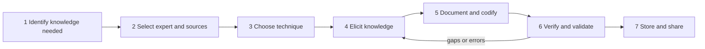

**In simple words:** knowledge capture ka matlab hai experts ko jo aata hai, khaaskar jo unke dimaag mein hai, use nikaalna aur aise written form mein badalna jo dusre use kar sakein. Jaise ek journalist chef ka interview leta hai jo kuch naapta nahi: dekho, "kyun kiya" poochho, likho, phir chef se check karwao.

**Definition:** knowledge capture experts, documents aur past work se knowledge nikaalne aur use explicit, usable form mein badalne ka process hai jise store aur share kiya ja sake. Expert-systems ki language mein ise knowledge acquisition kehte hain, jo knowledge engineer karta hai. <Cite id="knowledge-management-wiki-acquisition" /> <Cite id="knowledge-management-wiki-engineering" />

**Ye kyun important hai:** jab expert retire hota hai, knowledge uske saath chala jaata hai; capture use bachata hai. Ye sabse mushkil step bhi hai, kyunki experts ko aksar bas "pata hota hai".

**Steps**

1. **Capture karne wala knowledge identify karo:** process ya problem chuno, aur wo knowledge jo critical ya risk mein hai.
2. **Experts aur sources chuno:** asli experts ke saath documents aur past projects chuno, aur trust banao.
3. **Technique chuno** jo knowledge ke hisaab se fit ho (table dekho).
4. **Knowledge elicit karo:** sawaal poochho, expert ko kaam karte dekho, permission ke saath record karo.
5. **Document aur codify karo:** notes ko rules, procedures, decision trees, cases ya FAQs mein badlo.
6. **Verify aur validate karo:** expert check kare ki sahi record hua; real cases pe test karo ki kaam karta hai.
7. **Store aur share karo:** tags ke saath repository mein daalo taaki log dhoond sakein, aur regularly review karo.

**Techniques**

| Technique | Kaise kaam karta hai | Best for |
|---|---|---|
| Interviews | Expert se sawaal poochhna | Zyada tar situations |
| Observation | Expert ko asli kaam karte dekhna | Hands-on skills |
| Protocol analysis | Problem solve karte hue expert zor se sochta hai <Cite id="knowledge-management-wiki-protocol" /> | Reasoning steps |
| Brainstorming | Group freely ideas list karta hai | Kai experts se ideas |
| Delphi method | Experts rounds mein questionnaires bharte hain jab tak opinions paas na aa jayein | Forecasts |
| Concept mapping | Ideas ko linked nodes ki tarah draw karna | Ideas kaise judte hain |

**Example:** ek IT firm retire ho rahe senior engineer ka interview leti hai, fixes ko troubleshooting guide mein record karti hai, dusre engineers se check karwati hai, aur support knowledge base mein add karti hai.

**Conclusion:** capture knowledge ko insaan ke dimaag se checked, shared form mein le jaata hai; books steps ko alag number kar sakti hain, lekin logic wahi rehta hai. <Cite id="knowledge-management-gfg-intro" />
