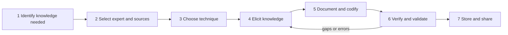

**In simple words:** knowledge capture means drawing out what experts know, especially what they carry in their heads, and turning it into a written form others can use. Like a journalist interviewing a chef who never measures anything: watch, ask why, write it down, then ask the chef to check.

**Definition:** knowledge capture is the process of drawing out knowledge from experts, documents and past work and turning it into an explicit, usable form that can be stored and shared. In expert-systems language it is called knowledge acquisition, done by a knowledge engineer. <Cite id="knowledge-management-wiki-acquisition" /> <Cite id="knowledge-management-wiki-engineering" />

**Why it matters:** it saves knowledge from walking out of the door when an expert retires. It is also the hardest step, because experts often "just know".

**Steps**

1. **Identify the knowledge to capture:** pick the process or problem, and the knowledge that is critical or at risk.
2. **Select experts and sources:** choose real experts plus documents and past projects, and build trust.
3. **Choose the technique** that fits the knowledge (see table).
4. **Elicit the knowledge:** ask questions, watch the expert work, record with permission.
5. **Document and codify:** turn notes into rules, procedures, decision trees, cases or FAQs.
6. **Verify and validate:** the expert checks that it was recorded correctly; test that it works on real cases.
7. **Store and share:** put it in the repository with tags so people can find it, and review it regularly.

**Techniques**

| Technique | How it works | Best for |
|---|---|---|
| Interviews | Ask the expert questions | Most situations |
| Observation | Watch the expert at the real job | Hands-on skills |
| Protocol analysis | The expert thinks aloud while solving a problem <Cite id="knowledge-management-wiki-protocol" /> | Reasoning steps |
| Brainstorming | A group lists ideas freely | Ideas from several experts |
| Delphi method | Experts answer questionnaires in rounds until opinions converge | Forecasts |
| Concept mapping | Draw ideas as linked nodes | How ideas connect |

**Example:** an IT firm interviews a retiring senior engineer, records fixes as a troubleshooting guide, has other engineers check it, and adds it to the support knowledge base.

**Conclusion:** capture moves knowledge from a person's head into a checked, shared form, and books may number the steps differently but the logic is the same. <Cite id="knowledge-management-gfg-intro" />
