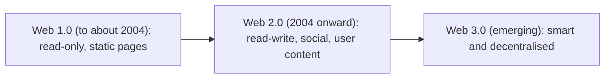

**In simple words:** web teen stages mein grow hua hai. Web 1.0 mein sirf padh sakte the, Web 2.0 mein likh aur share bhi kar sakte hain, aur Web 3.0 ka aim hai ki web meaning samjhe aur users apne data ke owner ho. Numbers bolne ka tareeka hain, software releases nahi.

**Web 1.0, read-only web.** Pages static hote hain, sabke liye same aur sirf owner badalta hai. Kuch log publish karte hain, zyada log padhte hain. Example: shuruaati company brochure sites aur Yahoo directory. <Cite id="social-computing-gfg-web-versions" />

**Web 2.0, read-write social web.** Users post, comment, like, upload aur edit karte hain. Pages bina reload ke respond karte hain (Ajax). Site ek platform hai aur users ka content uski value hai. Examples: Facebook, YouTube, Wikipedia, Instagram, Flipkart reviews. Ye term Tim O'Reilly ne popular kiya. <Cite id="social-computing-oreilly-web2" />

**Web 3.0, agla web.** Iski koi ek agreed definition nahi hai. Ise do tareeke se use karte hain: **Semantic Web**, jahan data mein clear meaning hota hai taaki machines use samjhein aur jodein, aur **Web3**, blockchain pe bana decentralised web jahan users apne data aur digital assets ke owner hote hain. Examples: semantic search, Ethereum apps, smart assistants. <Cite id="social-computing-wiki-semantic-web" />

**Comparison**

| Point | Web 1.0 | Web 2.0 | Web 3.0 |
|---|---|---|---|
| Nickname | Read-only web | Read-write social web | Smart, decentralised web |
| Content kaun banata hai | Kuch publishers | Users aur companies | Users, machines aur AI ke saath |
| Pages | Static | Dynamic, interactive | Intelligent, personalised |
| Data control | Site owner | Bade platforms | User (Web3 view mein) |
| Main technology | HTML, simple servers | Ajax, blogs, wikis, social networks, cloud | Semantic tags, AI, blockchain |
| Communication | One-way | Two-way, many-to-many | Machine-to-machine aur peer-to-peer bhi |
| Examples | Shuruaati brochure sites | Facebook, YouTube, Wikipedia | Semantic search, Ethereum apps |
| Weak point | Interaction nahi | Privacy loss, platform data ka owner | Complex, abhi early, rules unclear |

<Cite id="social-computing-av-web2-web3" />

**Similarity:** teeno internet pe chalte hain aur har stage pichle pe build hota hai.

**Conclusion:** Web 1.0 ne information available ki, Web 2.0 ne web ko social banaya, aur Web 3.0 ka aim hai ise meaningful aur user-owned banana.
