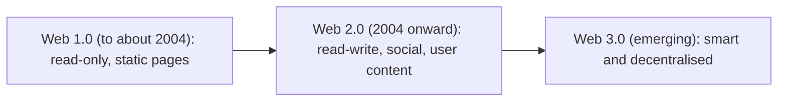

**In simple words:** the web has grown in three stages. Web 1.0 let you only read, Web 2.0 let you write and share, and Web 3.0 aims to make the web understand meaning and let users own their data. The numbers are a way of speaking, not software releases.

**Web 1.0, the read-only web.** Pages are static, the same for everyone and changed only by the owner. A few people publish, many read. Example: early company brochure sites and the Yahoo directory. <Cite id="social-computing-gfg-web-versions" />

**Web 2.0, the read-write social web.** Users post, comment, like, upload and edit. Pages respond without reloading (Ajax). The site is a platform and users' content is its value. Examples: Facebook, YouTube, Wikipedia, Instagram, Flipkart reviews. The term was popularised by Tim O'Reilly. <Cite id="social-computing-oreilly-web2" />

**Web 3.0, the next web.** There is no single agreed definition. It is used in two ways: the **Semantic Web**, where data carries clear meaning so machines can understand and connect it, and **Web3**, a decentralised web built on blockchain where users own their data and digital assets. Examples: semantic search, Ethereum apps, smart assistants. <Cite id="social-computing-wiki-semantic-web" />

**Comparison**

| Point | Web 1.0 | Web 2.0 | Web 3.0 |
|---|---|---|---|
| Nickname | Read-only web | Read-write social web | Smart, decentralised web |
| Content made by | A few publishers | Users and companies | Users, with machines and AI |
| Pages | Static | Dynamic, interactive | Intelligent, personalised |
| Data control | Site owner | Big platforms | User (in the Web3 view) |
| Main technology | HTML, simple servers | Ajax, blogs, wikis, social networks, cloud | Semantic tags, AI, blockchain |
| Communication | One-way | Two-way, many-to-many | Also machine-to-machine and peer-to-peer |
| Examples | Early brochure sites | Facebook, YouTube, Wikipedia | Semantic search, Ethereum apps |
| Weak point | No interaction | Privacy loss, platform owns data | Complex, early, unclear rules |

<Cite id="social-computing-av-web2-web3" />

**Similarity:** all three run on the internet and each stage builds on the earlier one.

**Conclusion:** Web 1.0 made information available, Web 2.0 made the web social, and Web 3.0 aims to make it meaningful and user-owned.
