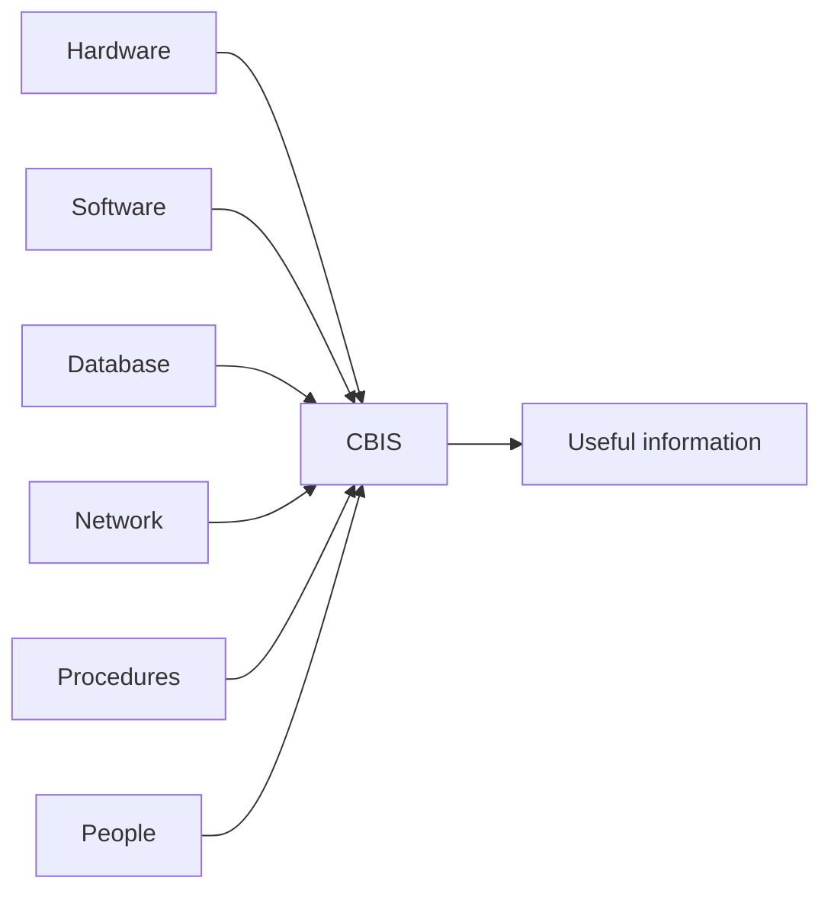

**In simple words:** computer-based information system (CBIS) ek aisa information system hai jo computer ki help se information ko collect, store, process aur share karta hai. Isme six parts hote hain, aur system tabhi chalta hai jab sab six maujood ho, jaise car ko body, engine, fuel, roads, rules aur driver sab chahiye. <Cite id="is-fundamentals-wiley-rainer" />

**Definition:** CBIS hardware, software, databases, networks, procedures aur people ka use karke raw data ko decisions ke liye useful information mein badalta hai.

**The six components**

1. **Hardware:** physical devices, jaise computers, servers, scanners, printers aur storage disks. Example: supermarket ke billing counter ke computers.
2. **Software:** wo programs jo hardware par chalte hain. System software operating system hota hai; application software koi kaam karta hai, jaise payroll ya billing.
3. **Database:** related data ka organized collection jo tables mein store hota hai. Example: customer, product aur order records.
4. **Network:** wired ya wireless links jinse computers data share karte hain. Example: bank apni branches aur ATMs ko jodta hai.
5. **Procedures:** system use karne ke written rules, jaise data kaise enter karna hai, backup kaise lena hai aur errors kaise handle karne hain.
6. **People:** users, operators, analysts, programmers aur managers jo system banate aur use karte hain. <Cite id="is-fundamentals-gfg-components" />

**Note:** kuch books sirf five likhti hain (hardware, software, data, network, people), isliye six likhna safe hai. <Cite id="is-fundamentals-wiki-is" />

**Conclusion:** hardware, software, database aur network technology parts hain; procedures aur people unhe ek working system banate hain.
