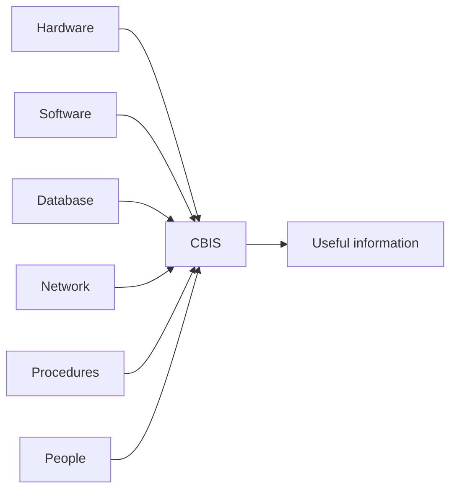

**In simple words:** a computer-based information system (CBIS) is an information system that uses computers to collect, store, process and share information. It has six parts, and it works only when all six are present, like a car that needs a body, engine, fuel, roads, rules and a driver. <Cite id="is-fundamentals-wiley-rainer" />

**Definition:** a CBIS uses hardware, software, databases, networks, procedures and people to turn raw data into useful information for decisions.

**The six components**

1. **Hardware:** the physical devices, such as computers, servers, scanners, printers and storage disks. Example: billing counter computers in a supermarket.
2. **Software:** the programs that run on the hardware. System software is the operating system; application software does a job, such as payroll or billing.
3. **Database:** an organized collection of related data stored in tables. Example: customer, product and order records.
4. **Network:** wired or wireless links that let computers share data. Example: a bank linking its branches and ATMs.
5. **Procedures:** the written rules for using the system, such as how to enter data, take backups and handle errors.
6. **People:** the users, operators, analysts, programmers and managers who build and use the system. <Cite id="is-fundamentals-gfg-components" />

**Note:** some books list only five (hardware, software, data, network, people), so writing all six is safe. <Cite id="is-fundamentals-wiki-is" />

**Conclusion:** hardware, software, database and network are the technology parts; procedures and people make them a working system.
