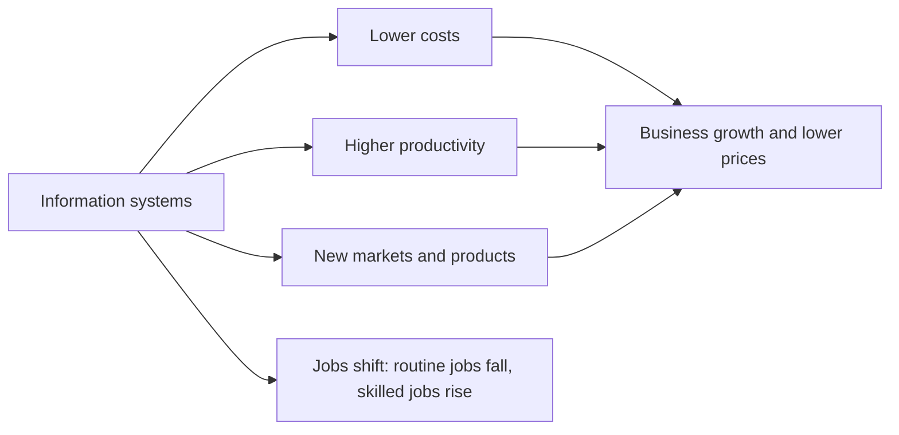

**In simple words:** information systems (IS) paisa kamane aur kharch karne ka tareeka badal dete hain. Wo business ko sasta aur fast banate hain, naye businesses aur jobs banate hain, aur kuch purani jobs hata bhi dete hain. Yehi economic impacts hain. <Cite id="it-impact-society-laudon-mis" />

**Definition:** IS ka economic impact matlab information technology ka firm aur poori economy mein costs, output, jobs, markets aur prices par effect. <Cite id="it-impact-society-porter-millar1985" />

**Economic impacts**

1. **Lower transaction costs:** supplier dhoondhna, prices compare karna aur order dena bas kuch clicks hain. Example: shop owner wholesale market jaane ki jagah B2B app par stock order karta hai.
2. **Lower coordination costs:** ek system se managers kai units control karte hain. Example: SBI hazaaron branches ek core-banking system par chalata hai.
3. **Higher productivity:** routine steps automate ho jaate hain. Example: supermarket mein barcode billing.
4. **Capital replaces labour:** firms repeat kaam ke liye log hire karne ki jagah systems kharidti hain. Isse cost kam hoti hai par job market badalta hai.
5. **New products, markets aur business models:** food delivery (Zomato), online shopping (Amazon, Flipkart) aur digital payments (UPI). Chhota artisan ab poore India mein bech sakta hai.
6. **New jobs aur industries:** software, IT services (Infosys), data analysts, delivery partners.
7. **Customers ko better prices aur choice:** online comparison se prices neeche aate hain.
8. **Globalization:** kaam border paar hota hai, jaise Indian IT firms foreign clients ko serve karti hain.

| Effect | Example |
|---|---|
| Lower transaction cost | Ordering stock on a B2B app |
| Higher productivity | Barcode billing |
| New markets | Artisan selling on Flipkart |
| Jobs shift | Clerk replaced, data analyst hired |

**Dono sides:** gains bade hain, lekin kuch workers routine jobs kho dete hain aur unhe nayi skills chahiye, aur digital divide kuch logon ko peeche chhod sakta hai. <Cite id="it-impact-society-wiki-tech-unemployment" /> <Cite id="it-impact-society-gfg-media-society" />

**Conclusion:** IS costs kam karta hai aur naye markets kholta hai, jisse economy badhti hai, lekin society ko workers ko nayi jobs ke liye retrain karna padta hai.
