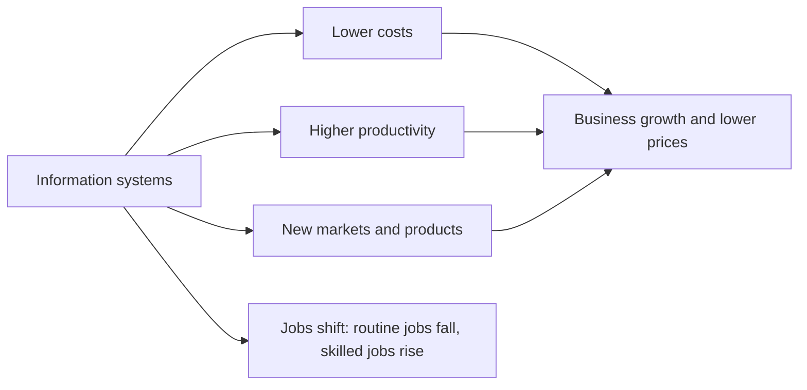

**In simple words:** information systems (IS) change how money is earned and spent. They make doing business cheaper and faster, create new businesses and jobs, and also remove some old jobs. These are the economic impacts. <Cite id="it-impact-society-laudon-mis" />

**Definition:** the economic impact of IS is the effect of information technology on costs, output, jobs, markets and prices in a firm and in the whole economy. <Cite id="it-impact-society-porter-millar1985" />

**Economic impacts**

1. **Lower transaction costs:** finding a supplier, comparing prices and ordering are a few clicks. Example: a shop owner orders stock on a B2B app instead of visiting a wholesale market.
2. **Lower coordination costs:** one system lets managers control many units. Example: SBI runs thousands of branches on one core-banking system.
3. **Higher productivity:** routine steps are automated. Example: barcode billing at a supermarket.
4. **Capital replaces labour:** firms buy systems instead of hiring for repeat tasks. This cuts cost but changes the job market.
5. **New products, markets and business models:** food delivery (Zomato), online shopping (Amazon, Flipkart) and digital payments (UPI). A small artisan can now sell across India.
6. **New jobs and industries:** software, IT services (Infosys), data analysts, delivery partners.
7. **Better prices and choice for customers:** online comparison pushes prices down.
8. **Globalization:** work moves across borders, for example Indian IT firms serving foreign clients.

| Effect | Example |
|---|---|
| Lower transaction cost | Ordering stock on a B2B app |
| Higher productivity | Barcode billing |
| New markets | Artisan selling on Flipkart |
| Jobs shift | Clerk replaced, data analyst hired |

**Both sides:** the gains are large, but some workers lose routine jobs and need new skills, and the digital divide can leave some people behind. <Cite id="it-impact-society-wiki-tech-unemployment" /> <Cite id="it-impact-society-gfg-media-society" />

**Conclusion:** IS lowers costs and opens new markets, which grows the economy, but society must retrain workers for the new jobs.
