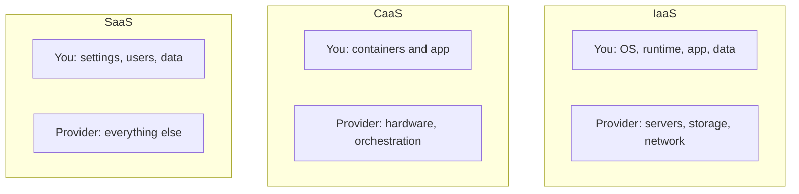

**In simple words:** cloud providers computing ko teen main tareekon se rent par dete hain. IaaS machines rent par deta hai, CaaS containers chalane ki ready jagah deta hai, aur SaaS ek finished software use karne ko deta hai. Dinner socho: IaaS khaali kitchen hai, CaaS standard lunch boxes delivery ke saath hain, SaaS pakka hua khana hai. <Cite id="note-cloud-computing-ibm-models" />

**1. IaaS (Infrastructure as a Service).** Provider internet par virtual servers, storage aur networking deta hai, pay-as-you-go. Operating system aur applications aap install aur manage karte ho. Examples: Amazon EC2, Azure Virtual Machines. <Cite id="note-cloud-computing-gfg-models" />
*Applications:* website hosting, backup aur storage, achanak traffic badhne par server capacity badhana, testing aur development.

**2. CaaS (Containers as a Service).** Container ek application ko uski zaroori libraries ke saath pack karta hai, taaki wo har jagah ek jaisa chale. CaaS developers ko portal ya API se containers upload, run, scale aur manage karne deta hai, automatic deployment aur scaling ke saath. Examples: Amazon ECS, Google Kubernetes Engine. <Cite id="note-cloud-computing-ibm-caas" /> <Cite id="note-cloud-computing-gfg-caas" />
*Applications:* microservices (login, cart aur payment alag chhoti services), DevOps pipelines, purani applications ko cloud par le jaana.

**3. SaaS (Software as a Service).** Provider ready application browser se deta hai, aam taur par subscription par, aur servers, updates aur security khud sambhalta hai. Examples: Salesforce CRM, Google Workspace, Microsoft 365, Zoom. <Cite id="note-cloud-computing-salesforce-saas" />
*Applications:* sales team ka cloud CRM use karna, email aur office documents, video meetings, HR aur accounting software.

| Point | IaaS | CaaS | SaaS |
|---|---|---|---|
| You get | Virtual machines, storage | Platform to run containers | Finished application |
| You manage | OS, apps, data | Containers and apps | Settings, data |
| Skill needed | High | Medium to high | Low |
| Main users | IT admins | Developers, DevOps | End users |

**Note:** kuch papers "CaaS" ko Communications as a Service ke liye use karte hain; yahan ise Containers as a Service maana gaya hai, isliye exam mein ye likh do. <Cite id="note-cloud-computing-ibm-models" />

**Conclusion:** control chahiye to IaaS, portable apps ke liye CaaS aur ready-to-use software ke liye SaaS chuno.
