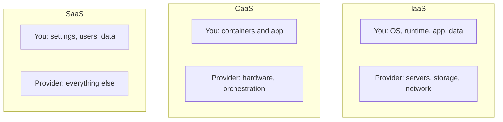

**In simple words:** cloud providers rent computing in three main ways. IaaS rents the machines, CaaS rents a ready place to run containers, and SaaS gives a finished software to use. Think of dinner: IaaS is an empty kitchen, CaaS is standard lunch boxes with delivery, SaaS is the cooked meal. <Cite id="note-cloud-computing-ibm-models" />

**1. IaaS (Infrastructure as a Service).** The provider gives virtual servers, storage and networking over the internet, pay-as-you-go. You install and manage the operating system and applications. Examples: Amazon EC2, Azure Virtual Machines. <Cite id="note-cloud-computing-gfg-models" />
*Applications:* hosting a website, backup and storage, adding server capacity in a sudden traffic rise, testing and development.

**2. CaaS (Containers as a Service).** A container packs an application with the libraries it needs so it runs the same everywhere. CaaS lets developers upload, run, scale and manage containers through a portal or API, with automatic deployment and scaling built in. Examples: Amazon ECS, Google Kubernetes Engine. <Cite id="note-cloud-computing-ibm-caas" /> <Cite id="note-cloud-computing-gfg-caas" />
*Applications:* microservices (login, cart and payment as separate small services), DevOps pipelines, moving old applications to the cloud.

**3. SaaS (Software as a Service).** The provider delivers a ready application through the browser, usually on subscription, and handles servers, updates and security. Examples: Salesforce CRM, Google Workspace, Microsoft 365, Zoom. <Cite id="note-cloud-computing-salesforce-saas" />
*Applications:* a sales team using a cloud CRM, email and office documents, video meetings, HR and accounting software.

| Point | IaaS | CaaS | SaaS |
|---|---|---|---|
| You get | Virtual machines, storage | Platform to run containers | Finished application |
| You manage | OS, apps, data | Containers and apps | Settings, data |
| Skill needed | High | Medium to high | Low |
| Main users | IT admins | Developers, DevOps | End users |

**Note:** some papers use "CaaS" for Communications as a Service; here it is taken as Containers as a Service, so state this in the exam. <Cite id="note-cloud-computing-ibm-models" />

**Conclusion:** choose IaaS for control, CaaS for portable apps and SaaS for ready-to-use software.
