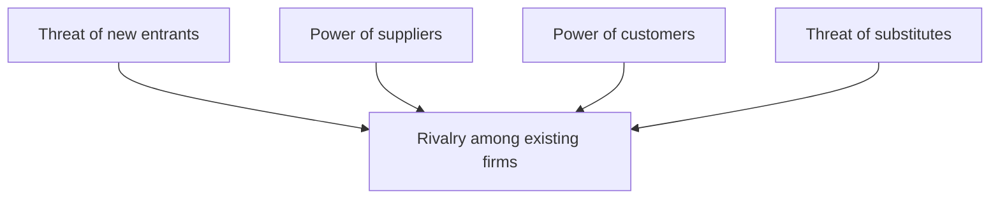

**In simple words:** competitive environment ka matlab hai bahut saari firms same customers ke liye ladti hain (aur firm ke andar teams performance par compete karti hain). Competition firms ko better banata hai, lekin pressure aur cost bhi laata hai. Ye answer dono sides ko contrast karta hai. <Cite id="it-impact-society-wiki-competitive-advantage" />

**Definition:** competitive environment aisa market ya workplace hai jahan kai rivals better price, quality ya service dekar same customers ya rewards jeetne ki koshish karte hain.

**Competitive forces.** Porter ki five forces batati hain ki market kitna tough hai: threat of new entrants, bargaining power of suppliers, bargaining power of customers, threat of substitutes aur rivalry among existing firms. Forces jitni strong, profit kamana utna mushkil. <Cite id="it-impact-society-porter-hbr2008" /> <Cite id="it-impact-society-hbs-five-forces" />

**Advantages versus disadvantages**

| Advantages | Disadvantages |
|---|---|
| Pushes the firm to innovate and improve products | Price wars cut profit margins |
| Forces efficiency and lower costs | High spending on marketing, technology and research |
| Customers get better quality, lower prices and more choice | Weak firms may fail and jobs are lost |
| Firm learns from rivals (benchmarking) | Temptation to cut corners on quality or ethics |
| Employees stay motivated and skills improve | Too much internal rivalry causes stress and less sharing |
| Encourages strategic use of IS to stay ahead | IS advantages are copied quickly, so the edge is short |

**Example:** Amazon aur Flipkart delivery speed aur price par compete karte hain. Customers ko faster delivery aur offers milte hain, lekin dono firms discounts par bahut kharch karti hain, jisse profit ghatta hai. <Cite id="it-impact-society-tp-five-forces" />

**IS se link:** jo system koi bhi rival khareed sakta hai wo sirf chhota advantage deta hai. Lasting edge tab aata hai jab IS ko firm ke apne processes, data aur people ke saath milaya jaaye.

**Conclusion:** competition customers ko fayda deta hai aur innovation chalata hai, lekin firms ka profit aur effort leta hai, isliye firm ko IS aur apni strengths use karke aage rehna padta hai.
