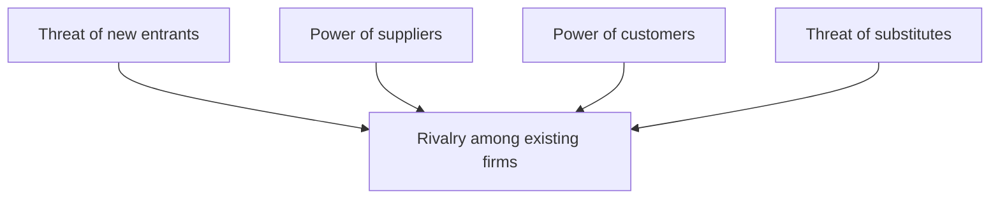

**In simple words:** a competitive environment means many firms fight for the same customers (and inside a firm, teams compete on performance). Competition makes firms better, but it also brings pressure and cost. This answer contrasts the two sides. <Cite id="it-impact-society-wiki-competitive-advantage" />

**Definition:** a competitive environment is a market, or workplace, where several rivals try to win the same customers or rewards by offering better price, quality or service.

**Competitive forces.** Porter's five forces explain how tough a market is: threat of new entrants, bargaining power of suppliers, bargaining power of customers, threat of substitutes and rivalry among existing firms. The stronger the forces, the harder it is to earn profit. <Cite id="it-impact-society-porter-hbr2008" /> <Cite id="it-impact-society-hbs-five-forces" />

**Advantages versus disadvantages**

| Advantages | Disadvantages |
|---|---|
| Pushes the firm to innovate and improve products | Price wars cut profit margins |
| Forces efficiency and lower costs | High spending on marketing, technology and research |
| Customers get better quality, lower prices and more choice | Weak firms may fail and jobs are lost |
| Firm learns from rivals (benchmarking) | Temptation to cut corners on quality or ethics |
| Employees stay motivated and skills improve | Too much internal rivalry causes stress and less sharing |
| Encourages strategic use of IS to stay ahead | IS advantages are copied quickly, so the edge is short |

**Example:** Amazon and Flipkart compete on delivery speed and price. Customers gain from faster delivery and offers, but both firms spend heavily on discounts, which reduces profit. <Cite id="it-impact-society-tp-five-forces" />

**Link to IS:** a system that any rival can buy gives only a short advantage. A lasting edge comes from combining IS with the firm's own processes, data and people.

**Conclusion:** competition benefits customers and drives innovation, but costs firms profit and effort, so a firm must use IS and its own strengths to stay ahead.
