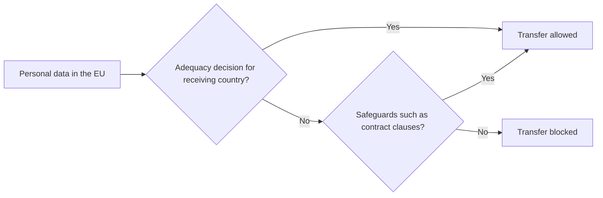

**In simple words:** transborder data flow (TDF) matlab personal data ka country border paar jaana, jaise Indian bank apne customer records abroad ke server par rakhe. Har country ka apna privacy law hota hai, isliye privacy rules decide karte hain ki aisa data kab, kaise aur jaa sakta hai ya nahi. <Cite id="ethics-privacy-ibm-data-privacy" />

**Definition:** transborder data flow data, khaaskar personal data, ka national borders ke paar movement hai. Privacy ek insaan ka right hai ki uski information kaise collect, use aur share ho, ye wo control kare.

**TDF kyun matter karta hai:** global business, cloud computing, outsourcing (Indian IT firms foreign clients ka data handle karti hain), e-commerce aur social media har second borders ke paar data bhejte hain. Lekin data strong protection wale country se weak protection wale country mein ja sakta hai.

**Impact of privacy issues on TDF**

1. **Transfer par restrictions:** strict laws data ko tabhi jaane dete hain jab receiving country utni hi protection de. EU ke GDPR ke under transfer ke liye adequacy decision ya standard contractual clauses jaise safeguards chahiye. <Cite id="ethics-privacy-gdpr-ch5" /> <Cite id="ethics-privacy-ec-adequacy" />
2. **Legal uncertainty:** EU Court of Justice ne Max Schrems ke cases ke baad EU-US Safe Harbour (2015) aur Privacy Shield (2020) arrangements ko khatam kar diya, isliye firms ko data transfer ka tareeka badalna pada. <Cite id="ethics-privacy-wiki-schrems" />
3. **Data localization:** kuch countries data ko country ke andar hi rakhne ko kehte hain. Isse privacy aur national control milta hai, lekin cost badhti hai aur internet bantt sakta hai. <Cite id="ethics-privacy-wiki-data-localization" />
4. **Zyada compliance cost aur delay:** har country ke liye contracts, audits aur legal advice. GDPR fines EUR 20 million ya worldwide turnover ka 4% tak ho sakte hain, jo bhi zyada ho.
5. **Trade aur outsourcing par asar:** weak privacy law wale countries business kho sakte hain; strong law wale clients ko attract karte hain.
6. **Jurisdiction conflict:** saaf nahi hota ki kis country ka law aur courts lagenge jab data ek country mein store, doosre mein process aur teesre ke person ka ho.

| Free flow | Restricted flow |
|---|---|
| Lower cost, global business, cloud services | Protects citizens' privacy |
| Faster innovation | Easier for the state to enforce law |
| Helps outsourcing countries like India | Raises cost, may block services |

**Conclusion:** privacy rules cross-border data flow ko slow kar sakte hain aur cost badha sakte hain, lekin wo trust banate hain jo global business ko chahiye.
