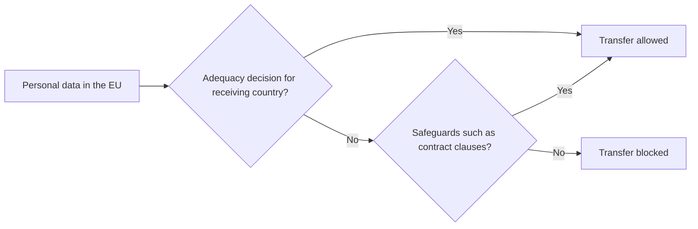

**In simple words:** a transborder data flow (TDF) is personal data crossing a country border, for example an Indian bank keeping customer records on a server abroad. Every country has its own privacy law, so privacy rules decide when, how and whether such data may leave. <Cite id="ethics-privacy-ibm-data-privacy" />

**Definition:** transborder data flow is the movement of data, especially personal data, across national borders. Privacy is a person's right to control how their information is collected, used and shared.

**Why TDF matters:** global business, cloud computing, outsourcing (Indian IT firms handle foreign clients' data), e-commerce and social media send data across borders every second. But the data may move from a country with strong protection to one with weak protection.

**Impact of privacy issues on TDF**

1. **Restrictions on transfer:** strict laws let data leave only if the receiving country protects it equally. Under the EU's GDPR, a transfer needs an adequacy decision or safeguards such as standard contractual clauses. <Cite id="ethics-privacy-gdpr-ch5" /> <Cite id="ethics-privacy-ec-adequacy" />
2. **Legal uncertainty:** the EU Court of Justice struck down the EU-US Safe Harbour (2015) and Privacy Shield (2020) arrangements after cases brought by Max Schrems, so firms had to change how they transfer data. <Cite id="ethics-privacy-wiki-schrems" />
3. **Data localization:** some countries require data to stay inside the country. This protects privacy and national control, but raises cost and may split the internet. <Cite id="ethics-privacy-wiki-data-localization" />
4. **Higher compliance cost and delay:** contracts, audits and legal advice for each country. GDPR fines can reach EUR 20 million or 4% of worldwide turnover, whichever is higher.
5. **Effect on trade and outsourcing:** countries with weak privacy law may lose business; those with strong law attract clients.
6. **Jurisdiction conflict:** unclear which country's law and courts apply when data is stored in one country, processed in another and owned by a person in a third.

| Free flow | Restricted flow |
|---|---|
| Lower cost, global business, cloud services | Protects citizens' privacy |
| Faster innovation | Easier for the state to enforce law |
| Helps outsourcing countries like India | Raises cost, may block services |

**Conclusion:** privacy rules can slow cross-border data flow and add cost, but they build the trust that global business needs.
