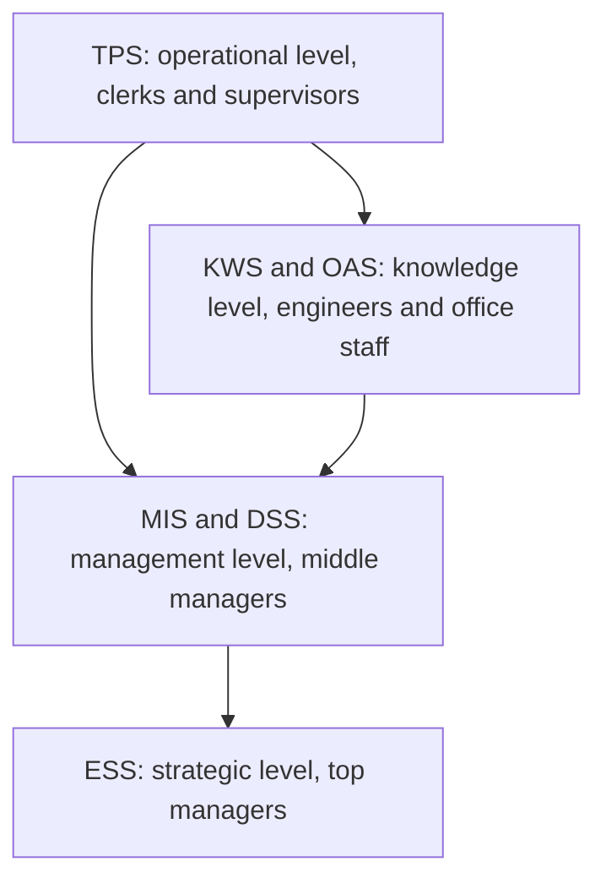

**In simple words:** company mein alag-alag logon ko alag information chahiye. Clerk ko har ek transaction chahiye; CEO ko ek page ka summary. Isliye companies har level ke liye alag type ka information system (IS) use karti hain. <Cite id="is-fundamentals-gfg-types" />

**Definition:** information system people, hardware, software, data aur procedures ka set hai jo information ko collect, process, store aur share karta hai taaki operations aur decisions support ho sakein. <Cite id="is-fundamentals-wiki-is" />

**Types of IS**

1. **Transaction Processing System (TPS):** sales, deposits aur payroll jaise routine daily transactions record karta hai, batch ya real time mein. Users: clerks. Example: SBI ATM withdrawal.
2. **Office Automation System (OAS):** email, documents aur scheduling jaise office kaam support karta hai. Example: Microsoft Office, email.
3. **Knowledge Work System (KWS):** engineers aur designers ko naya knowledge aur designs banane mein help karta hai. Example: CAD software.
4. **Management Information System (MIS):** TPS data ko middle managers ke liye regular summary aur exception reports mein badalta hai. Example: Flipkart ki daily sales-by-city report.
5. **Decision Support System (DSS):** managers ko data aur models par what-if questions test karne deta hai, semi-structured problems ke liye. Example: price cut ka effect forecast karna.
6. **Executive Support System (ESS):** top executives ko key figures ka dashboard deta hai, drill-down aur outside data ke saath. Example: CEO ka revenue, profit aur market share dashboard.
7. **Expert System (ES):** stored facts aur if-then rules se human expert ki reasoning copy karta hai. Example: medical diagnosis help. <Cite id="is-fundamentals-tp-ess" />

| Type | Level | Users | Output | Example |
|---|---|---|---|---|
| TPS | Operational | Clerks | Detailed records | ATM, billing |
| OAS / KWS | Knowledge | Office staff, engineers | Documents, designs | Email, CAD |
| MIS | Management | Middle managers | Periodic reports | Monthly sales report |
| DSS | Management | Managers | What-if analysis | Loan analysis |
| ESS | Strategic | Top executives | Dashboards | CEO dashboard |

**Conclusion:** types aapas mein linked hain, kyunki TPS data MIS aur DSS ko feed karta hai, jo ESS ko feed karte hain. <Cite id="is-fundamentals-pearson-laudon" />
