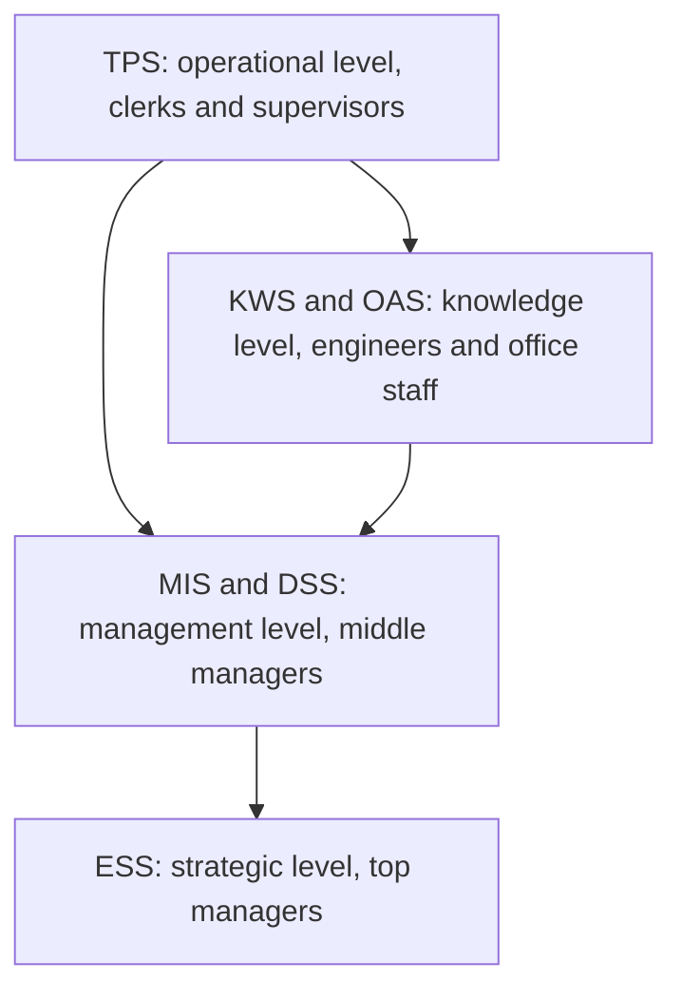

**In simple words:** different people in a company need different information. A clerk needs every single transaction; the CEO needs a one-page summary. So companies use different types of information systems (IS), one for each level. <Cite id="is-fundamentals-gfg-types" />

**Definition:** an information system is a set of people, hardware, software, data and procedures that collects, processes, stores and shares information to support operations and decisions. <Cite id="is-fundamentals-wiki-is" />

**Types of IS**

1. **Transaction Processing System (TPS):** records routine daily transactions such as sales, deposits and payroll, in batch or real time. Users: clerks. Example: an SBI ATM withdrawal.
2. **Office Automation System (OAS):** supports office work such as email, documents and scheduling. Example: Microsoft Office, email.
3. **Knowledge Work System (KWS):** helps engineers and designers create new knowledge and designs. Example: CAD software.
4. **Management Information System (MIS):** turns TPS data into regular summary and exception reports for middle managers. Example: Flipkart's daily sales-by-city report.
5. **Decision Support System (DSS):** lets managers test what-if questions on data and models for semi-structured problems. Example: forecasting the effect of a price cut.
6. **Executive Support System (ESS):** gives top executives a dashboard of key figures with drill-down and outside data. Example: a CEO's dashboard of revenue, profit and market share.
7. **Expert System (ES):** copies a human expert's reasoning using stored facts and if-then rules. Example: medical diagnosis help. <Cite id="is-fundamentals-tp-ess" />

| Type | Level | Users | Output | Example |
|---|---|---|---|---|
| TPS | Operational | Clerks | Detailed records | ATM, billing |
| OAS / KWS | Knowledge | Office staff, engineers | Documents, designs | Email, CAD |
| MIS | Management | Middle managers | Periodic reports | Monthly sales report |
| DSS | Management | Managers | What-if analysis | Loan analysis |
| ESS | Strategic | Top executives | Dashboards | CEO dashboard |

**Conclusion:** the types are linked, since TPS data feeds MIS and DSS, which feed the ESS. <Cite id="is-fundamentals-pearson-laudon" />
