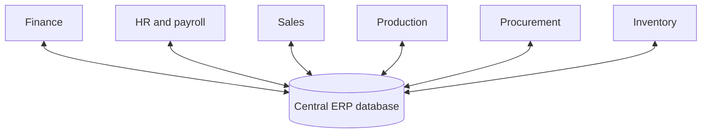

**In simple words:** ERP poori company ke liye ek bada software hai jahan har department same shared data use karta hai. Iske bahut benefits hain, lekin ye costly hai aur lagana mushkil hai. <Cite id="note-tps-fais-erp-tp-erp" />

**Definition:** enterprise resource planning (ERP) ek integrated, real-time software system hai jo ek shared database par bana hai aur poore organization ke core business processes ko support karta hai: finance, HR, supply chain, manufacturing aur sales. <Cite id="crm-rainer-iis" /> <Cite id="note-tps-fais-erp-wiki-erp" />

**Ye kyun zaroori hai:** jab har department ka apna system hota hai, ek hi customer kai baar store hota hai, numbers match nahi karte aur orders baar-baar type hote hain. ERP data ek baar enter karta hai aur sabke saath share karta hai. <Cite id="note-tps-fais-erp-sap-india" />

| Advantages | Drawbacks |
|---|---|
| One shared database gives one version of the truth | Very high cost: licences, consultants, training |
| Data entered once, so fewer errors and less duplicate work | Long, complex implementation, often months or years |
| Real-time reports and better decisions | Firm may have to change its processes to fit the software |
| Better coordination between departments | Staff resistance and heavy training |
| Better inventory, cost and cash control | Heavy customisation causes delay and bugs |
| Better customer service and forecasting | Dependence on one vendor, hard to link other systems |
| Standard, secure, auditable processes | If it fails, the whole firm is affected |

<Cite id="note-tps-fais-erp-tpoint-erp-adv" />

**Example:** Walmart jaisa retailer stores, warehouses, suppliers aur finance ko ek planning system par jodta hai, isliye stock time par order hota hai. Leading products SAP aur Oracle hain. Chhoti shop ke liye cost bahut zyada hogi.

**Conclusion:** ERP medium aur large firms ke liye faydemand hai jo achhi planning karein, staff train karein aur data clean rakhein; warna cost aur disruption gain se zyada ho sakta hai.
