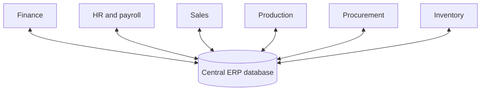

**In simple words:** ERP is one big software for the whole company where every department uses the same shared data. It brings many benefits, but it is costly and hard to introduce. <Cite id="note-tps-fais-erp-tp-erp" />

**Definition:** enterprise resource planning (ERP) is an integrated, real-time software system built on one shared database that supports the core business processes of the whole organization: finance, HR, supply chain, manufacturing and sales. <Cite id="crm-rainer-iis" /> <Cite id="note-tps-fais-erp-wiki-erp" />

**Why it is needed:** when each department has its own system, the same customer is stored many times, numbers do not match and orders are typed again and again. ERP enters data once and shares it with all. <Cite id="note-tps-fais-erp-sap-india" />

| Advantages | Drawbacks |
|---|---|
| One shared database gives one version of the truth | Very high cost: licences, consultants, training |
| Data entered once, so fewer errors and less duplicate work | Long, complex implementation, often months or years |
| Real-time reports and better decisions | Firm may have to change its processes to fit the software |
| Better coordination between departments | Staff resistance and heavy training |
| Better inventory, cost and cash control | Heavy customisation causes delay and bugs |
| Better customer service and forecasting | Dependence on one vendor, hard to link other systems |
| Standard, secure, auditable processes | If it fails, the whole firm is affected |

<Cite id="note-tps-fais-erp-tpoint-erp-adv" />

**Example:** a retailer such as Walmart links stores, warehouses, suppliers and finance on one planning system, so stock is ordered on time. Leading products are SAP and Oracle. A small shop would find the cost too high.

**Conclusion:** ERP pays off for medium and large firms that plan well, train staff and keep data clean; otherwise cost and disruption can outweigh the gain.
