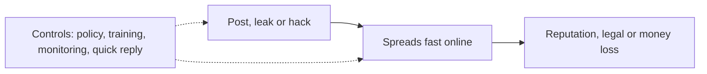

**In simple words:** social computing (Facebook, X, Instagram, WhatsApp, YouTube, review sites) kisi ko bhi business ke baare mein turant baat karne deta hai. Ye openness aur speed marketing ke liye achhi hai, lekin wahi openness risks bhi banati hai. <Cite id="social-computing-wiki-social-computing" />

**Definition:** social computing wo use hai jisme social networks, blogs, wikis aur messaging apps jaise web tools se log online connect, share aur saath kaam karte hain.

**Risks to business**

1. **Reputation ko damage:** ek bura post, video ya review firm ke react karne se pehle lakhon tak phail jaata hai. Example: 2009 mein "United Breaks Guitars" video, jo damaged luggage ke baare mein tha, bahut phaila aur airline ki image ko nuksaan hua.
2. **Hacked ya fake accounts:** hacker firm ke naam se jhooti news post karta hai. Example: 2013 mein Associated Press ka Twitter account hack hua aur jhooti explosion report post hui, aur share prices kuch der ke liye gire.
3. **Privacy aur data misuse:** customer data bina sahi consent ke collect ya leak hota hai, jisse fines lagte hain. Example: Cambridge Analytica case, jisme Facebook users ka data bina sahi consent ke liya gaya. <Cite id="ethics-privacy-wiki-cambridge-analytica" />
4. **Security threats:** phishing links aur malware social messages se phailte hain, aur staff ko tricks karke passwords le liye ja sakte hain. Example: messaging apps par fake "offer" links. <Cite id="note-information-security-gfg-phishing" />
5. **Confidential information leak:** employee koi secret post kar deta hai, jaise unreleased product ki photo.
6. **Legal aur intellectual property problems:** copyright breach, defamation aur ads mein jhoote claims.
7. **Fake aur paid reviews:** customers misled hote hain aur trust girta hai.
8. **Productivity loss:** staff kaam ke time social sites par waste karta hai.
9. **Control ka loss:** trolls aur rumours ko aasani se hata nahi sakte.

**Risks kaise kam karein:** social media policy likho aur staff ko train karo, strong passwords aur two-factor login ke saath official verified accounts use karo, mentions monitor karo, jaldi aur honestly reply karo, privacy laws follow karo aur crisis plan rakho. <Cite id="it-impact-society-laudon-mis" /> <Cite id="social-computing-wiki-social-crm" />

**Conclusion:** social computing reach aur feedback deta hai, lekin bina management ke ye ghanton mein brand ko damage kar sakta hai, isliye firms ko rules aur active monitoring chahiye.
