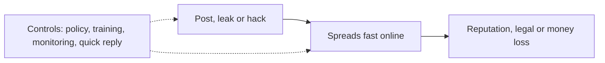

**In simple words:** social computing (Facebook, X, Instagram, WhatsApp, YouTube, review sites) lets anyone talk about a business instantly. That openness and speed helps marketing, but the same openness creates risks. <Cite id="social-computing-wiki-social-computing" />

**Definition:** social computing is the use of web tools such as social networks, blogs, wikis and messaging apps for people to connect, share and work together online.

**Risks to business**

1. **Damage to reputation:** one bad post, video or review spreads to millions before the firm reacts. Example: in 2009 the video "United Breaks Guitars" about damaged luggage spread widely and hurt the airline's image.
2. **Hacked or fake accounts:** a hacker posts false news in the firm's name. Example: in 2013 the Associated Press Twitter account was hacked and posted a false explosion report, and share prices briefly fell.
3. **Privacy and data misuse:** customer data is collected or leaked without proper consent, leading to fines. Example: the Cambridge Analytica case, in which Facebook user data was harvested without proper consent. <Cite id="ethics-privacy-wiki-cambridge-analytica" />
4. **Security threats:** phishing links and malware spread by social messages, and staff may be tricked into giving passwords. Example: fake "offer" links on messaging apps. <Cite id="note-information-security-gfg-phishing" />
5. **Leak of confidential information:** an employee posts a secret, such as a photo of an unreleased product.
6. **Legal and intellectual property problems:** copyright breach, defamation and false claims in ads.
7. **Fake and paid reviews:** customers are misled and trust falls.
8. **Loss of productivity:** staff waste working time on social sites.
9. **Loss of control:** trolls and rumours cannot be removed easily.

**How to reduce the risks:** write a social media policy and train staff, use official verified accounts with strong passwords and two-factor login, monitor mentions, reply quickly and honestly, follow privacy laws and keep a crisis plan. <Cite id="it-impact-society-laudon-mis" /> <Cite id="social-computing-wiki-social-crm" />

**Conclusion:** social computing brings reach and feedback, but unmanaged it can damage a brand within hours, so firms need rules and active monitoring.
