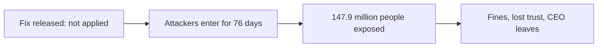

**In simple words:** yes. A company that holds other people's data is like a locker attendant holding your valuables. Leaving the locker open because locking was "too much work" is wrong, even if no rule forced him. Security is a duty, not only a technical task. <Cite id="ethics-privacy-rainer-ch3" />

**Definition:** an ethical responsibility is a duty to do what is right and not harm others. Information security is the protection of information from unauthorized access, change or loss. Together: an organization that collects data must protect it.

**Why security is an ethical responsibility**

1. **Duty of care:** the data belongs to customers, who trust the firm with it.
2. **Harm to real people:** a leak causes fraud, identity theft, stress and money loss.
3. **Privacy depends on security:** data cannot be private if it is not secure.
4. **Accountability:** the firm must answer for failures, report them honestly and quickly, and fix them.
5. **Trust in society:** people use digital services only if they believe data is safe. <Cite id="is-fundamentals-pearson-laudon" /> <Cite id="ethics-privacy-gfg-ethical-issues" />

**Case study: Equifax breach, 2017.** Equifax is a large US credit reporting company. A fix for a flaw in the Apache Struts web software was released on 7 March 2017, but Equifax did not apply it to one of its websites. Attackers used the flaw from May 2017, and the breach went unnoticed for 76 days. About 147.9 million people had names, birth dates, social security numbers and addresses exposed. <Cite id="note-information-security-wiki-equifax" />

Consequences: the share price fell about 13 percent in a day, the CEO retired, and in 2019 Equifax agreed to settlements of at least about USD 575 million with US regulators and states. <Cite id="ethics-privacy-ftc-equifax" />

**Ethical lessons:** failure of responsibility (not patching), of accountability (late detection and disclosure) and exposure to liability (penalties and claims). The people harmed never chose to give Equifax their data, which makes the duty stronger.

| Without ethical security | With ethical security |
|---|---|
| Fraud and identity theft for customers | Safe, trusting customers |
| Fines, lawsuits, lost reputation for the firm | Trust and loyalty |

**Conclusion:** security is an ethical responsibility, because protecting data protects people, and the Equifax case shows the cost of ignoring it.
