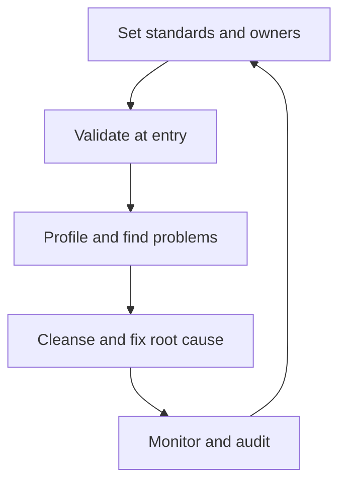

**In simple words:** bura data bure decisions deta hai ("garbage in, garbage out"). Data quality ka matlab hai data us kaam ke layak ho jiske liye use ho raha hai. Organization ise rules set karke, data enter hote waqt check karke, use clean karke aur hamesha nazar rakhkar ensure karti hai. <Cite id="data-management-ibm-data-quality" />

**Achha data kya hai (dimensions of quality)** <Cite id="data-management-wiki-data-quality" />

| Dimension | Question it asks | Bad example |
|---|---|---|
| Accuracy | Is the value correct? | Wrong date of birth |
| Completeness | Is anything missing? | Customer with no phone number |
| Consistency | Do systems agree? | Different addresses in sales and billing |
| Timeliness | Is it up to date? | Last month's stock levels |
| Validity | Does it follow format rules? | PIN code with 5 digits |
| Uniqueness | Is each thing recorded once? | Same customer entered twice |

**Quality kaise ensure hoti hai**

1. **Standards set karo (data governance):** har field aur uske rules define karo, aur decide karo ki owner kaun hai. <Cite id="data-management-ibm-data-governance" />
2. **Entry par validate karo:** drop-down lists, format checks aur mandatory fields errors ko source par rokte hain, jo fix karne ki sabse sasti jagah hai.
3. **Data profile karo:** tables scan karke missing values, duplicates aur ajeeb values napo.
4. **Cleanse karo:** errors theek karo, gaps bharo aur duplicates hatao.
5. **Master data management (MDM) use karo:** har customer ya product ka ek trusted record rakho aur doosre systems ko usse check karo. <Cite id="data-management-gfg-mdm" />
6. **Root cause dhoondho:** ek hi error repeat ho (kharab form, untrained clerk) to sirf record nahi, process theek karo.
7. **Responsibility assign karo:** data owners aur stewards apne data ke liye jawabdeh hote hain.
8. **Continuously monitor karo:** data-quality dashboards aur regular audits, kyunki data purana hota hai jab log move karte hain aur prices badalte hain.

**Example:** Flipkart jaisi e-commerce firm entry par check karti hai ki PIN code mein six digits hon, duplicate customers merge karti hai, aur galat addresses se failed deliveries ka share track karti hai.

**Conclusion:** quality governance, entry par checks, regular cleansing aur continuous monitoring se ensure hoti hai, taaki managers apne data par bharosa kar sakein.
