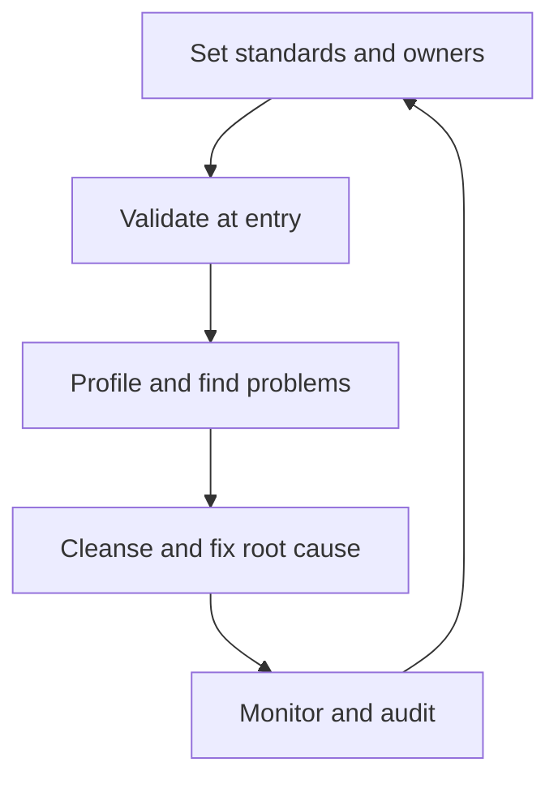

**In simple words:** bad data gives bad decisions ("garbage in, garbage out"). Data quality means the data is fit for the job it is used for. An organization ensures it by setting rules, checking data when it enters, cleaning it and watching it all the time. <Cite id="data-management-ibm-data-quality" />

**What good data means (dimensions of quality)** <Cite id="data-management-wiki-data-quality" />

| Dimension | Question it asks | Bad example |
|---|---|---|
| Accuracy | Is the value correct? | Wrong date of birth |
| Completeness | Is anything missing? | Customer with no phone number |
| Consistency | Do systems agree? | Different addresses in sales and billing |
| Timeliness | Is it up to date? | Last month's stock levels |
| Validity | Does it follow format rules? | PIN code with 5 digits |
| Uniqueness | Is each thing recorded once? | Same customer entered twice |

**How quality is ensured**

1. **Set standards (data governance):** define each field and its rules, and decide who owns it. <Cite id="data-management-ibm-data-governance" />
2. **Validate at entry:** drop-down lists, format checks and mandatory fields stop errors at the source, the cheapest place to fix them.
3. **Profile the data:** scan tables to measure missing values, duplicates and odd values.
4. **Cleanse:** correct errors, fill gaps and remove duplicates.
5. **Use master data management (MDM):** keep one trusted record for each customer or product and check other systems against it. <Cite id="data-management-gfg-mdm" />
6. **Find root causes:** if the same error repeats (a bad form, an untrained clerk), fix the process, not only the record.
7. **Assign responsibility:** data owners and stewards answer for their data.
8. **Monitor continuously:** data-quality dashboards and regular audits, because data decays as people move and prices change.

**Example:** an e-commerce firm such as Flipkart checks that a PIN code has six digits at entry, merges duplicate customers, and tracks the share of failed deliveries caused by wrong addresses.

**Conclusion:** quality is ensured by governance, checks at entry, regular cleansing and continuous monitoring, so managers can trust their data.
