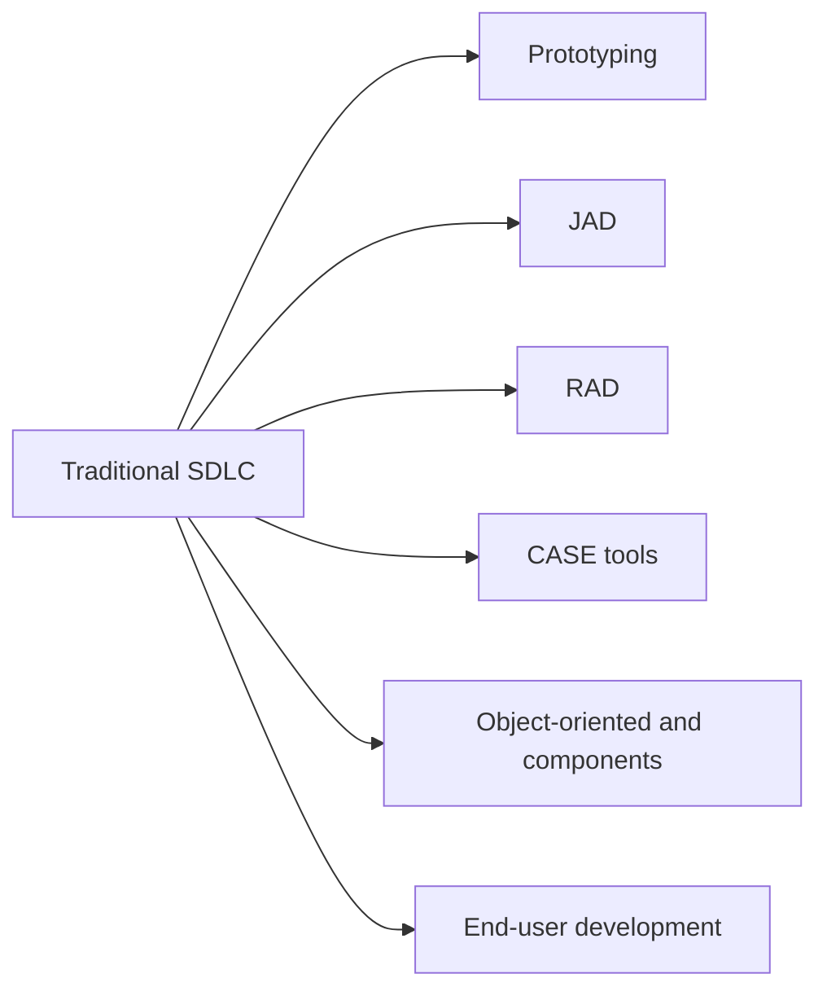

**In simple words:** traditional SDLC (system development life cycle) slow aur rigid hota hai: users ko system sirf end mein dikhta hai, aur late changes bahut costly hote hain. Isliye ismein kuch tools aur methods jode jaate hain taaki development faster, sasta ya users ki need ke zyada paas ho. <Cite id="it-impact-society-rainer-iis7" loc="Ch. 1" />

1. **Prototyping:** ek chhota working model banao, users ko dikhao, feedback lo aur improve karo. Isse galatfehmiyan jaldi pakadti hain, jaise building banne se pehle sample flat dikhana. <Cite id="note-sdlc-gfg-prototype" />
2. **Joint application design (JAD):** ek workshop jahan users, managers aur analysts kuch din mein saath baith ke requirements pe agree karte hain, bahut saare alag interviews ki jagah.
3. **Rapid application development (RAD):** prototyping, JAD, CASE tools aur reusable parts ko short time-boxes ke saath milata hai, taaki working system hafton ya mahino mein mile. <Cite id="note-sdlc-wiki-rad" />
4. **CASE tools:** software jo developers ko diagrams banane, requirements repository rakhne, code aur documentation generate karne aur consistency check karne mein help karta hai. Upper CASE analysis aur design mein help karta hai; lower CASE coding aur testing mein. <Cite id="note-sdlc-wiki-case" />
5. **Object-oriented aur component-based development:** system reusable objects aur components se banta hai, isse time aur bugs bachte hain.
6. **End-user development:** users spreadsheets ya low-code tools se chhoti applications khud banate hain. Ye fast aur sasta hai, lekin errors aur security gaps se bachne ke liye control chahiye.

| Tool | Benefit | Limit |
|---|---|---|
| Prototyping | Early user feedback | Quick model ko final system samajhne ka risk |
| JAD | Fast agreement | Saare key logon ka saath hona zaroori |
| RAD | Fast delivery | Bahut bade systems ke liye nahi |
| CASE | Manual kaam kam | Costly, training chahiye |

**Conclusion:** ye tools SDLC ke phases rakhte hain lekin unhe chhota karte hain aur users ko pehle se involve karte hain.
