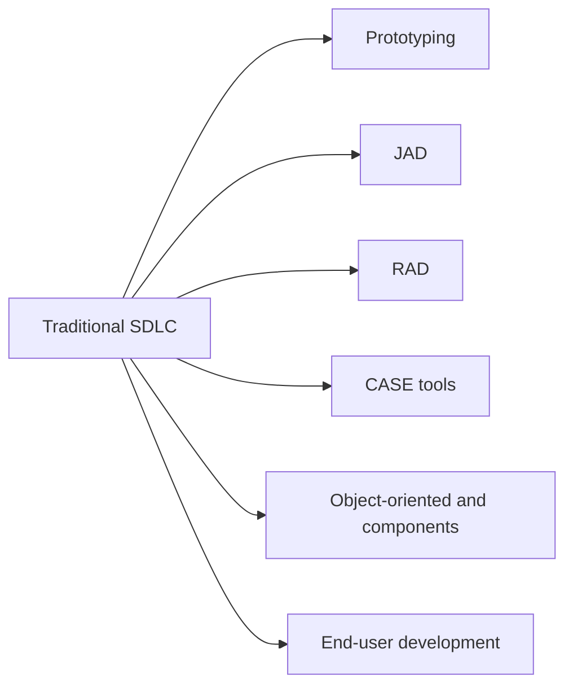

**In simple words:** the traditional SDLC (system development life cycle) is slow and rigid: users see the system only at the end, and late changes cost a lot. Several tools and methods are added to it to make development faster, cheaper or closer to what users want. <Cite id="it-impact-society-rainer-iis7" loc="Ch. 1" />

1. **Prototyping:** build a small working model, show it to users, collect feedback and improve it. It finds misunderstandings early, like a sample flat shown before the building is built. <Cite id="note-sdlc-gfg-prototype" />
2. **Joint application design (JAD):** a workshop where users, managers and analysts agree on requirements together in a few days instead of many separate interviews.
3. **Rapid application development (RAD):** combines prototyping, JAD, CASE tools and reusable parts with short time-boxes, so a working system comes in weeks or months. <Cite id="note-sdlc-wiki-rad" />
4. **CASE tools:** software that helps developers draw diagrams, keep a requirements repository, generate code and documentation, and check consistency. Upper CASE helps analysis and design; lower CASE helps coding and testing. <Cite id="note-sdlc-wiki-case" />
5. **Object-oriented and component-based development:** the system is built from reusable objects and components, which saves time and bugs.
6. **End-user development:** users build small applications with spreadsheets or low-code tools. It is fast and cheap but needs control to avoid errors and security gaps.

| Tool | Benefit | Limit |
|---|---|---|
| Prototyping | Early user feedback | A quick model may be mistaken for the final system |
| JAD | Fast agreement | Needs all key people together |
| RAD | Fast delivery | Not for very large systems |
| CASE | Less manual work | Costly, needs training |

**Conclusion:** these tools keep the SDLC phases but shorten them and involve users earlier.
