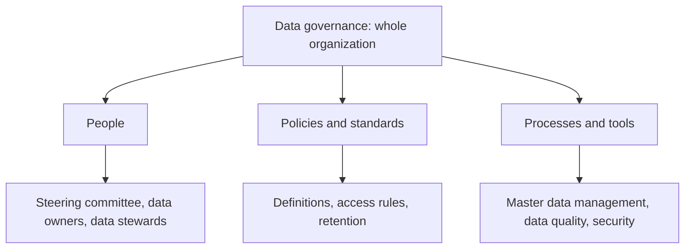

**In simple words:** database data store karta hai, lekin ye decide nahi karta ki data ka owner kaun hai, uska matlab kya hai, quality kitni achhi honi chahiye ya use kaun dekh sakta hai. Poore organization mein information manage karne wala approach **data governance** hai. Socho shehar ke traffic rules: sirf roads kaafi nahi, rules, signs aur traffic police bhi chahiye. <Cite id="data-management-wiki-data-governance" />

**Definition:** data governance policies, standards, roles aur processes ka set hai jo decide karta hai ki poore organization mein data kaise create, store, use, protect aur retire hoga. IBM ise data ki quality, security aur availability manage karna kehta hai. <Cite id="data-management-ibm-data-governance" />

**Approach ki categories**

1. **People:** steering committee ya chief data officer strategy set karta hai; data owners (business managers) data ke ek area ke liye accountable hote hain; data stewards roz ki dekhbhal karte hain.
2. **Policies aur standards:** common definitions (jaise "active customer" kise kehte hain), format rules, access rules aur data kitne time rakhna hai.
3. **Processes aur tools:** master data management (har customer ya product ka ek trusted "golden record"), data quality checks aur access security. <Cite id="data-management-ibm-mdm" /> <Cite id="data-management-gfg-mdm" />

**Benefits:** one version of the truth, behtar data quality, leaks ka kam risk aur GDPR aur India ke DPDP Act jaise laws ka compliance aasan.

**Example:** ek bank apne loan, card aur mobile app systems mein ek hi customer record use karta hai, aur sirf authorized staff use dekh sakta hai.

**Conclusion:** data governance, master data management ki madad se, poore organization mein information ko asset ki tarah manage karta hai.
