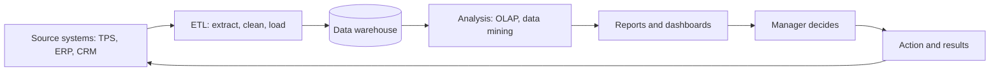

**In simple words:** business intelligence (BI) firm ke bikhre hue data ko reports aur dashboards mein badal deta hai, taaki managers guess ki jagah facts se decide karein. Socho car ka dashboard: speed aur fuel ek nazar mein dikh jaate hain, driver ko andaza nahi lagana padta.

**Definition:** BI applications, technologies aur processes ka set hai jo data collect, store, access aur analyse karta hai taaki business users behtar decisions le sakein. <Cite id="business-intelligence-wiki-bi" /> <Cite id="business-intelligence-ibm-bi" />

**Decision making pe impact**

1. **Fact-based decisions:** data intuition aur opinion ki jagah leta hai.
2. **Faster decisions:** data pehle se integrated hai, isliye jawab hafton ki jagah minutes mein milta hai. <Cite id="business-intelligence-gfg-bi" />
3. **Business ka single view:** sales, finance aur stock ek saath dikhte hain.
4. **Behtar forecasting:** trends se demand aur budget plan hota hai.
5. **Early warning:** dashboards girti sales ya badhti cost ko jaldi flag karte hain.
6. **Customer ko samajhna:** data mining buying patterns dikhata hai, targeted offers ke liye.
7. **Har level pe decisions:** self-service BI sirf executives ki nahi, operational staff ki bhi help karta hai.
8. **Measurement:** KPIs (key performance indicators) dikhate hain ki decision kaam kiya ya nahi. <Cite id="business-intelligence-tp-bi" />

| Point | BI ke bina | BI ke saath |
|---|---|---|
| Basis | Experience, guess | Data aur trends |
| Speed | Report ke liye din ya hafte | Minutes, live dashboard |
| View | Alag-alag department reports | Ek combined view |
| Problems | Nuksan ke baad dikhti hain | Pehle se warning |

**Example:** ek retail chain ke dashboard mein dikhta hai ki North India mein winter jackets ki sales do hafte pehle se badh rahi hain. Manager turant southern stores se stock shift karta hai aur shortage se bachta hai. Amazon aur Flipkart bhi aisa hi analysis karte hain ki kis warehouse mein kya stock rakhna hai.

**Limits:** kharab data quality galat jawab deti hai, setup cost zyada hai, bahut saare dashboards se overload hota hai, aur numbers human judgment ki jagah nahi le sakte.

**Conclusion:** BI decisions ko faster, better informed aur measurable banata hai, bas data clean ho aur managers judgment bhi use karein.
