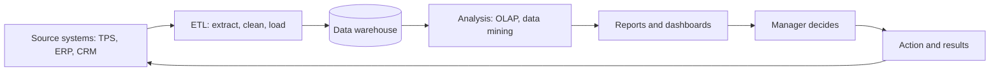

**In simple words:** business intelligence (BI) turns a firm's scattered data into reports and dashboards, so managers decide using facts instead of guesses. Think of a car dashboard: speed and fuel are shown at a glance, so the driver need not guess.

**Definition:** BI is a set of applications, technologies and processes for collecting, storing, accessing and analysing data to help business users make better decisions. <Cite id="business-intelligence-wiki-bi" /> <Cite id="business-intelligence-ibm-bi" />

**Impact on decision making**

1. **Fact-based decisions:** data replaces intuition and opinion.
2. **Faster decisions:** data is already integrated, so answers come in minutes, not weeks. <Cite id="business-intelligence-gfg-bi" />
3. **Single view of the business:** sales, finance and stock are seen together.
4. **Better forecasting:** trends help plan demand and budgets.
5. **Early warning:** dashboards flag falling sales or rising cost early.
6. **Customer understanding:** data mining shows buying patterns for targeted offers.
7. **Decisions at every level:** self-service BI helps operational staff, not only executives.
8. **Measurement:** KPIs (key performance indicators) show whether a decision worked. <Cite id="business-intelligence-tp-bi" />

| Point | Without BI | With BI |
|---|---|---|
| Basis | Experience, guess | Data and trends |
| Speed | Days or weeks for a report | Minutes, live dashboard |
| View | Separate department reports | One combined view |
| Problems seen | After the loss | Early warning |

**Example:** a retail chain's dashboard shows winter jacket sales in North India rising two weeks early. The manager moves stock from southern stores at once and avoids a shortage. Amazon and Flipkart use similar analysis to decide what stock to keep in which warehouse.

**Limits:** poor data quality gives wrong answers, setup cost is high, too many dashboards cause overload, and numbers cannot replace human judgment.

**Conclusion:** BI makes decisions faster, better informed and measurable, provided the data is clean and managers still use judgment.
