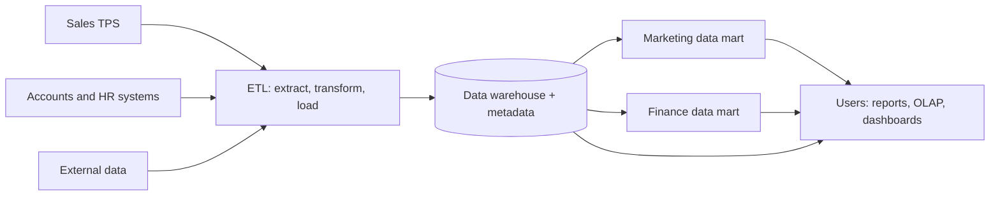

**In simple words:** data warehouse poori company ke cleaned, historical data ka ek bada store hai, jo sirf analysis ke liye bana hai. Socho hotel chain ka central kitchen: ingredients kai suppliers se aate hain, clean aur sort hote hain, aur har restaurant apni zaroorat ka lega.

**Ye kyun zaroori hai:** "paanch saal ki region-wise sales" jaise heavy sawal billing system ko slow kar dete hain, aur data kai systems mein alag formats mein padha hota hai. Isliye data ko ek alag store mein copy kiya jaata hai jo analysis ke liye bana ho.

**Definition:** data warehouse kai sources se aaye current aur historical data ka central store hai, jo reporting aur decision making ke liye organized hota hai. Bill Inmon ne ise **subject-oriented, integrated, time-variant and non-volatile** bataya. <Cite id="data-management-tp-dwh-overview" /> <Cite id="data-management-ibm-data-warehouse" />

- **Subject-oriented:** customer, product ya sales ke hisaab se organized, program ke hisaab se nahi.
- **Integrated:** alag sources ka data ek format aur ek set of codes mein.
- **Time-variant:** saalon ki history rakhta hai taaki trends dikhein.
- **Non-volatile:** load aur read hota hai, daily kaam se badalta nahi.

**Kaise kaam karta hai**

1. Operational systems aur bahar ke sources se data **extract** karo.
2. **Transform:** errors clean karo, duplicates hatao, common formats use karo.
3. Warehouse mein **load** karo, metadata (data ke baare mein data) ke saath jo batata hai ki har item ka matlab kya hai. <Cite id="data-management-gfg-data-warehousing" />
4. **Use:** managers reports, OLAP aur data mining chalate hain, ya ek department ke liye chhota **data mart** lete hain.

| Operational database | Data warehouse |
|---|---|
| Daily transactions | Analysis aur reports |
| Current data | Current aur historical data |
| Hamesha badalta rehta hai | Mostly read only |
| Bahut saare chhote updates | Kam, bade queries |

**Organization mein use**

- Walmart aur Flipkart har store ya city ki festival-wise sales study karte hain.
- Bank customer history analyse karke loan offers design karta hai aur fraud pakadta hai.
- Hospital group saalon ke treatment results study karta hai.

**Advantages:** ek consistent view, trends ke liye history, daily kaam slow kiye bina fast analysis. **Disadvantages:** costly aur banane mein slow, data cleaning mushkil, aur data thoda purana ho sakta hai. <Cite id="data-management-wiki-data-warehouse" />

**Conclusion:** warehouse decisions ke liye company ko data ka ek trusted source deta hai, aur data marts har department ko uska hissa dete hain.
