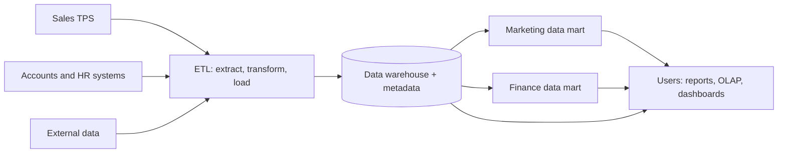

**In simple words:** a data warehouse is one big store of cleaned, historical data from the whole company, built only for analysis. Think of a hotel chain's central kitchen: ingredients arrive from many suppliers, are cleaned and sorted, and every restaurant takes what it needs.

**Why it is needed:** heavy questions like "sales by region for five years" slow down the billing system, and the data sits in many systems in different formats. So the data is copied into a separate store made for analysis.

**Definition:** a data warehouse is a central store of current and historical data gathered from many sources, organized for reporting and decision making. Bill Inmon described it as **subject-oriented, integrated, time-variant and non-volatile**. <Cite id="data-management-tp-dwh-overview" /> <Cite id="data-management-ibm-data-warehouse" />

- **Subject-oriented:** organized by customer, product or sales, not by program.
- **Integrated:** data from different sources in one format with one set of codes.
- **Time-variant:** keeps years of history so trends can be seen.
- **Non-volatile:** loaded and read, not changed by daily work.

**How it works**

1. **Extract** data from operational systems and outside sources.
2. **Transform:** clean errors, remove duplicates, use common formats.
3. **Load** into the warehouse, with metadata (data about the data) describing what each item means. <Cite id="data-management-gfg-data-warehousing" />
4. **Use:** managers run reports, OLAP and data mining, or take a smaller **data mart** for one department.

| Operational database | Data warehouse |
|---|---|
| Daily transactions | Analysis and reports |
| Current data | Current and historical data |
| Changes all the time | Mostly read only |
| Many small updates | Few big queries |

**Use in an organization**

- Walmart and Flipkart study sales per store or city per festival.
- A bank analyses customer history to design loan offers and spot fraud.
- A hospital group studies treatment results over years.

**Advantages:** one consistent view, history for trends, fast analysis without slowing daily work. **Disadvantages:** costly and slow to build, data cleaning is hard, and data may be slightly old. <Cite id="data-management-wiki-data-warehouse" />

**Conclusion:** the warehouse gives the company one trusted source of data for decisions, and data marts deliver the part each department needs.
