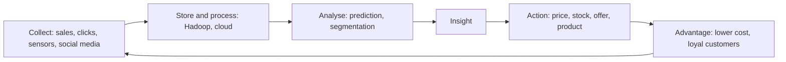

**In simple words:** big data matlab itna bada, tez aur varied data (clicks, videos, sensor readings, transactions) ki ordinary tools use handle nahi kar paate. Company ko edge tab milti hai jab wo kuch aisa dekh aur use kar sake jo uske rivals nahi dekh paate, aur big data analysis aise hi hidden patterns dikhata hai. Socho ek shopkeeper jo har customer ki aadat yaad rakhta hai, lekin millions of customers ke liye. <Cite id="data-management-ibm-big-data" />

**Competitive advantage** wo hai jo firm ko rivals se behtar karne deta hai, jaise lower cost, better product ya faster service. <Cite id="it-impact-society-wiki-competitive-advantage" />

**Company big data kaise use kar sakti hai**

1. **Customers ko behtar jaano:** customers ko bahut chhote segments mein baanto aur personalized offers do. Amazon aur Flipkart "customers who bought this also bought" dikhate hain. <Cite id="data-management-sas-big-data" />
2. **Events predict karo:** demand forecast karo, kaun si machines kharab hone wali hain (predictive maintenance) wo pehchano aur fraud jaldi pakdo.
3. **Cost kam karo aur operations sudharo:** stock, routes aur staffing optimize karo. Walmart sales data se shelves bhari rakhta hai aur stock kam rakhta hai.
4. **Faster decisions:** near real-time dashboards se managers mahino ki jagah ghanton mein react karte hain. <Cite id="data-management-aws-big-data" />
5. **Experiments chalao:** web page ya price ke do versions test karo aur jeetne wala rakho.
6. **Dynamic pricing:** demand ke saath price badlo, jaise airlines aur ride apps karte hain.
7. **Naye products aur business models:** jaise driving data se tay hone wali usage-based insurance.
8. **Risk manage karo:** banks unusual transactions real time mein flag karte hain.

| Strategy | Big data use | Example |
|---|---|---|
| Low cost | Demand forecast, route planning | Walmart, Zomato delivery routes |
| Differentiation | Personal offers, naye features | Amazon recommendations |
| Customer focus | Feedback aur social media analysis | Telecom firms churn kam karti hain |

**Limitations:** skilled logon aur costly systems chahiye, kharab data galat jawab deta hai, aur personal data use karne se privacy aur legal issues aate hain.

**Conclusion:** big data tabhi advantage deta hai jab firm insight ko tez action mein badle; sirf data collect karna kaafi nahi.
