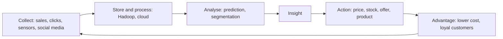

**In simple words:** big data means data so large, fast and varied (clicks, videos, sensor readings, transactions) that ordinary tools cannot handle it. A company gains an edge when it can see and act on something its rivals cannot, and big data analysis shows exactly such hidden patterns. Think of a shopkeeper who remembers every customer's habits, but for millions of customers. <Cite id="data-management-ibm-big-data" />

**Competitive advantage** is anything that lets a firm do better than rivals, such as lower cost, a better product or faster service. <Cite id="it-impact-society-wiki-competitive-advantage" />

**How a company can use big data**

1. **Know customers better:** group customers into very small segments and personalize offers. Amazon and Flipkart show "customers who bought this also bought". <Cite id="data-management-sas-big-data" />
2. **Predict events:** forecast demand, spot machines likely to fail (predictive maintenance) and detect fraud early.
3. **Cut cost and improve operations:** optimize stock, routes and staffing. Walmart uses sales data to keep shelves stocked while holding less stock.
4. **Faster decisions:** near real-time dashboards let managers react within hours, not months. <Cite id="data-management-aws-big-data" />
5. **Run experiments:** test two versions of a web page or price and keep the winner.
6. **Dynamic pricing:** change prices with demand, as airlines and ride apps do.
7. **New products and business models:** for example, usage-based insurance priced from driving data.
8. **Manage risk:** banks flag unusual transactions in real time.

| Strategy | Big data use | Example |
|---|---|---|
| Low cost | Demand forecast, route planning | Walmart, Zomato delivery routes |
| Differentiation | Personal offers, new features | Amazon recommendations |
| Customer focus | Feedback and social media analysis | Telecom firms reduce churn |

**Limitations:** needs skilled people and costly systems, poor data gives wrong answers, and using personal data raises privacy and legal issues.

**Conclusion:** big data gives an advantage only when the firm turns insight into quick action; collecting data alone is not enough.
