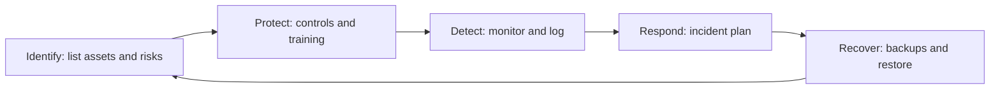

**In simple words:** cyber security behtar karne ke liye firm un weak points ko band karti hai jo attackers use karte hain, aur us din ki taiyari karti hai jab kuch phir bhi galat ho jaaye. Socho ek ghar: achhe locks (technology), careful family members (people), ghar ke rules (policy) aur fire plan (recovery), sab zaroori hain. <Cite id="note-information-security-nist-csf" /> <Cite id="note-information-security-gfg-infosec" />

**Measures examples ke saath**

1. **Risks identify karo:** assets (servers, customer data) ki list banao aur risks ko rank karo. Example: bank dekhta hai ki uska internet banking server sabse valuable target hai.
2. **Strong authentication:** lambe passwords ke saath multi-factor authentication (doosra proof, jaise OTP). Example: UPI apps ko PIN aur registered phone chahiye. <Cite id="note-information-security-wiki-mfa" />
3. **Software updated rakho:** patching known holes band karti hai. Example: WannaCry (2017) un computers pe laga jo patched nahi the.
4. **Network protection:** firewall, remote staff ke liye VPN, aur intrusion detection jo attacks pe nazar rakhta hai.
5. **Malware protection:** har computer pe antivirus, aur phishing ke khilaf email filters.
6. **Encryption:** data ko scramble karna taaki chor use padh na sakein. Example: Amazon checkout pe HTTPS padlock.
7. **Least privilege:** har insaan ko sirf utna access jitna job ko chahiye. Example: helpdesk agent salaries nahi dekh sakta.
8. **Backups aur recovery plan:** copies offline rakho aur restore karke test karo. Example: ransomware ke baad bina paise diye restore karna.
9. **Staff ko train karo:** zyadatar attacks insaan ke click se shuru hote hain. Example: bank ya IT firm apne staff ko mock phishing emails bhejti hai.
10. **Audit, monitor aur report karo:** regular checks, logs, aur crimes ko CERT-In aur cyber crime portal pe report karna. <Cite id="note-information-security-cisa-practices" />

| Control ka type | List ke measures |
|---|---|
| Technical | 2, 3, 4, 5, 6 |
| Administrative (people aur rules) | 1, 7, 9, 10 |
| Recovery | 8 |

**Limit:** koi bhi measure 100 percent safety nahi deta, isliye kai layers use karo aur unhe aksar review karo.

**Conclusion:** cyber security tab behtar hoti hai jab technology, trained people aur tested recovery plans saath kaam karte hain.
