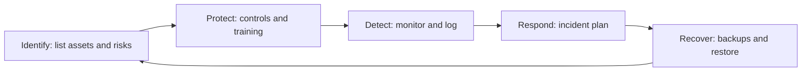

**In simple words:** to improve cyber security, a firm closes the weak points attackers use and prepares for the day something still goes wrong. Think of a house: good locks (technology), careful family members (people), house rules (policy) and a fire plan (recovery) all matter. <Cite id="note-information-security-nist-csf" /> <Cite id="note-information-security-gfg-infosec" />

**Measures with examples**

1. **Identify risks:** list assets (servers, customer data) and rank the risks. Example: a bank finds that its internet banking server is the most valuable target.
2. **Strong authentication:** long passwords plus multi-factor authentication (a second proof, such as an OTP). Example: UPI apps need a PIN and the registered phone. <Cite id="note-information-security-wiki-mfa" />
3. **Keep software updated:** patching closes known holes. Example: WannaCry (2017) hit computers that were not patched.
4. **Network protection:** firewall, VPN for remote staff, and intrusion detection that watches for attacks.
5. **Malware protection:** antivirus on every computer, and email filters against phishing.
6. **Encryption:** scrambling data so thieves cannot read it. Example: HTTPS padlock on Amazon checkout.
7. **Least privilege:** each person gets only the access the job needs. Example: a helpdesk agent cannot see salaries.
8. **Backups and recovery plan:** keep copies offline and test restoring. Example: restoring after ransomware without paying.
9. **Train staff:** most attacks start with a human click. Example: a bank or IT firm sends mock phishing emails to its staff.
10. **Audit, monitor and report:** regular checks, logs, and reporting crimes to CERT-In and the cyber crime portal. <Cite id="note-information-security-cisa-practices" />

| Type of control | Measures from the list |
|---|---|
| Technical | 2, 3, 4, 5, 6 |
| Administrative (people and rules) | 1, 7, 9, 10 |
| Recovery | 8 |

**Limit:** no measure gives 100 percent safety, so use several layers and review them often.

**Conclusion:** cyber security improves when technology, trained people and tested recovery plans work together.
