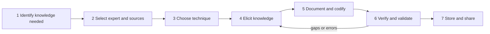

**In simple words:** knowledge capture matlab experts jo jaante hain, khaaskar jo unke dimaag mein hai, use bahar nikaal ke aise written form mein badalna jo doosre use kar sakein. Jaise ek journalist ek chef ka interview leta hai jo kuch napta nahi: dekho, kyun poochho, likho, phir chef se check karwao.

**Definition:** knowledge capture experts, documents aur past work se knowledge nikaal ke use explicit, usable form mein badalne ka process hai, jise store aur share kiya ja sake. Expert-systems ki language mein ise knowledge acquisition kehte hain, jo knowledge engineer karta hai. <Cite id="knowledge-management-wiki-acquisition" /> <Cite id="knowledge-management-wiki-engineering" />

**Ye kyun important hai:** jab expert retire hota hai to knowledge uske saath bahar chala jaata hai, ye use bachata hai. Ye sabse mushkil step bhi hai, kyunki experts ko aksar bas "pata hota hai".

**Steps**

1. **Capture karne wala knowledge identify karo:** process ya problem chuno, aur wo knowledge jo critical ya at risk hai.
2. **Experts aur sources chuno:** asli experts ke saath documents aur past projects lo, aur trust banao.
3. **Technique chuno** jo knowledge ke hisaab se fit ho (table dekho).
4. **Knowledge elicit karo:** sawal poochho, expert ko kaam karte dekho, permission ke saath record karo.
5. **Document aur codify karo:** notes ko rules, procedures, decision trees, cases ya FAQs mein badlo.
6. **Verify aur validate karo:** expert check karta hai ki sahi record hua; real cases pe test karo.
7. **Store aur share karo:** tags ke saath repository mein rakho taaki log dhoondh sakein, aur regularly review karo.

**Techniques**

| Technique | Kaise kaam karti hai | Kis ke liye best |
|---|---|---|
| Interviews | Expert se sawal poochhna | Zyadatar situations |
| Observation | Expert ko asli kaam pe dekhna | Hands-on skills |
| Protocol analysis | Expert problem solve karte time zor se sochta hai <Cite id="knowledge-management-wiki-protocol" /> | Reasoning steps |
| Brainstorming | Group freely ideas list karta hai | Kai experts ke ideas |
| Delphi method | Experts rounds mein questionnaires bharte hain jab tak opinions mil na jaayein | Forecasts |
| Concept mapping | Ideas ko linked nodes ki tarah draw karna | Ideas kaise jude hain |

**Example:** ek IT firm retiring senior engineer ka interview leti hai, fixes ko troubleshooting guide ki tarah record karti hai, doosre engineers se check karwati hai, aur use support knowledge base mein daal deti hai.

**Conclusion:** capture knowledge ko insaan ke dimaag se nikaal ke checked, shared form mein le aata hai. Books steps ko alag number de sakti hain, lekin logic wahi hai. <Cite id="knowledge-management-gfg-intro" />
