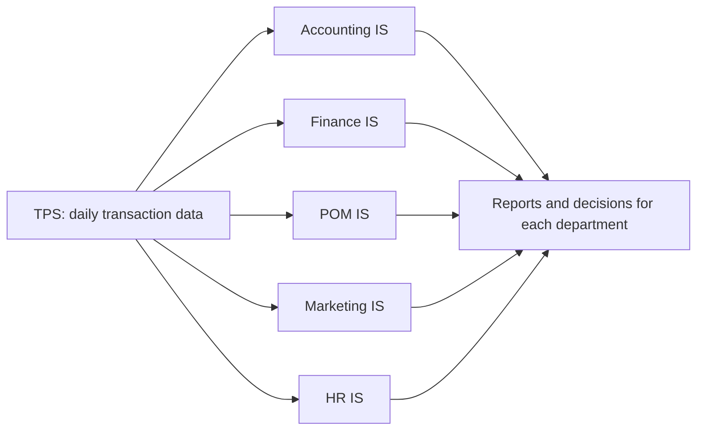

**In simple words:** functional area information system (FAIS) firm ke ek department ke liye bana system hota hai. Har ek apne department ka daily transaction data (TPS data) leta hai aur us department ko reports, planning help aur control deta hai. <Cite id="crm-rainer-iis" /> <Cite id="it-impact-society-tp-mis" />

| FAIS | Support ke types | Example |
|---|---|---|
| **Accounting IS** | Paise ke saare events record aur report karta hai: general ledger, accounts payable aur receivable, billing, payroll, budgets, financial statements, auditing aur internal control, cost accounting | Vendor ko pay karne se pehle invoice, goods receipt aur purchase order match karta hai <Cite id="note-tps-fais-erp-wiki-ais" /> |
| **Finance IS** | Paise ka aana-jaana manage karta hai: cash management, investment decisions, budgeting, financial forecasting aur analysis, credit aur risk, financial markets aur rates | Agle quarter ka cash forecast karta hai aur decide karta hai ki extra cash kahan invest karna hai |
| **Production and operations management (POM) IS** | Goods ya services banane ko plan aur control karta hai: inventory control, purchasing aur supplier management, production planning aur scheduling, quality control, maintenance, logistics | Material requirements planning batata hai ki kya kab kharidna hai <Cite id="note-tps-fais-erp-wiki-mrp" /> |
| **Marketing IS** | Product, price, place aur promotion ko support karta hai: market research, customer data, sales forecasting, sales tracking, pricing, advertising results, customer service | Flipkart dekhta hai ki kaun se offers kis city mein sales badhate hain |
| **Human resources IS** | Logon ko manage karta hai: recruitment, records, payroll aur benefits, attendance aur leave, training, performance appraisal, workforce planning, rules aur compliance | HRIS payslips deta hai aur leave aur training track karta hai <Cite id="note-tps-fais-erp-wiki-hris" /> |

**Common benefits:** har department ko faster reports, kam errors, behtar control aur planning mein help milti hai.

**Limitation:** har system ek department ke liye bana hai, isliye data repeat hota hai aur departments mein match nahi karta. ERP (enterprise resource planning) ise solve karta hai, sab functions ko ek shared database pe rakh ke.

**Conclusion:** paanchon FAIS kramshah accounting, finance, operations, marketing aur HR ke daily kaam, control aur planning ko support karte hain.
