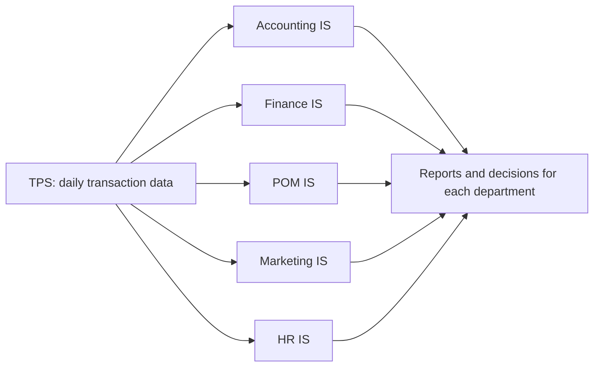

**In simple words:** a functional area information system (FAIS) is a system built for one department of a firm. Each one takes the daily transaction data (TPS data) of its department and gives that department reports, planning help and control. <Cite id="crm-rainer-iis" /> <Cite id="it-impact-society-tp-mis" />

| FAIS | Types of support provided | Example |
|---|---|---|
| **Accounting IS** | Records and reports all money events: general ledger, accounts payable and receivable, billing, payroll, budgets, financial statements, auditing and internal control, cost accounting | Matches an invoice, goods receipt and purchase order before paying a vendor <Cite id="note-tps-fais-erp-wiki-ais" /> |
| **Finance IS** | Manages money in and out: cash management, investment decisions, budgeting, financial forecasting and analysis, credit and risk, financial markets and rates | Forecasts cash for the next quarter and decides where to invest surplus cash |
| **Production and operations management (POM) IS** | Plans and controls making goods or services: inventory control, purchasing and supplier management, production planning and scheduling, quality control, maintenance, logistics | Material requirements planning works out what to buy and when <Cite id="note-tps-fais-erp-wiki-mrp" /> |
| **Marketing IS** | Supports product, price, place and promotion: market research, customer data, sales forecasting, sales tracking, pricing, advertising results, customer service | Flipkart studies which offers raise sales in which city |
| **Human resources IS** | Manages people: recruitment, records, payroll and benefits, attendance and leave, training, performance appraisal, workforce planning, rules and compliance | An HRIS issues payslips and tracks leave and training <Cite id="note-tps-fais-erp-wiki-hris" /> |

**Common benefits:** each department gets faster reports, fewer errors, better control and help in planning.

**Limitation:** each system is built for one department, so data is repeated and may not match across departments. ERP (enterprise resource planning) solves this by putting all functions on one shared database.

**Conclusion:** the five FAIS support the daily work, control and planning of accounting, finance, operations, marketing and HR respectively.
