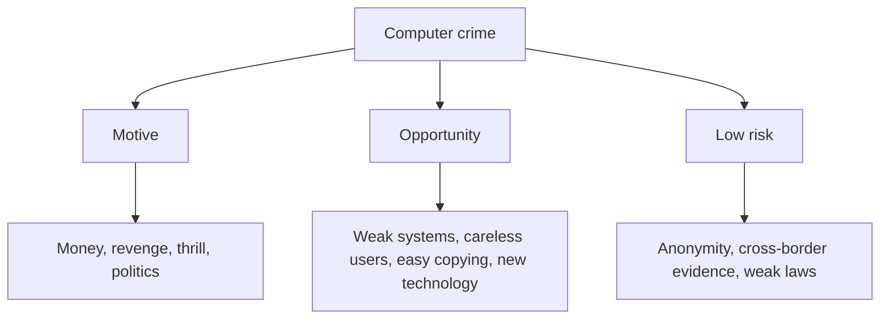

**In simple words:** computer crime (cybercrime) koi bhi illegal kaam hai jismein computer ya network tool, target ya crime ki jagah ho. Criminals isliye attack karte hain kyunki ye sasta hai, isme paisa milta hai, aur pakde kam jaate hain. <Cite id="ethics-privacy-wiki-cybercrime" /> <Cite id="note-information-security-gfg-cybercrime" />

**Computer crimes ke examples:** hacking, phishing, identity theft, online fraud, ransomware aur viruses failana.

**Main reasons** <Cite id="ethics-privacy-gfg-cybercrime-causes" /> <Cite id="ethics-privacy-gfg-cyber-criminals" />

| # | Reason | Short example |
|---|---|---|
| 1 | **Weak systems:** unpatched software, weak passwords, poor access control | Attackers purane unpatched server ko use karte hain |
| 2 | **Awareness ki kami:** users phishing links pe click karte hain, passwords reuse karte hain, OTP share karte hain | Fake bank SMS card number chura leta hai |
| 3 | **Financial gain:** fraud, ransomware aur chora hua data bechna achha paisa deta hai | Ransomware cryptocurrency mein payment maangta hai |
| 4 | **Data ki easy copying:** digital data seconds mein copy ho jaata hai, aksar bahut kam nishaan chhodta hai | Employee customer list pen drive mein copy kar leta hai |
| 5 | **Anonymity:** attacker door aur chhupa hota hai | Fraudster doosre desh se call karta hai |
| 6 | **Pakde jaane ka kam chance:** borders ke paar evidence jama karna mushkil | Cases saalon tak unsolved rehte hain |
| 7 | **Insiders:** legitimate access wale staff uska misuse karte hain | Clerk customer data bech deta hai |
| 8 | **Revenge, thrill ya political motives** | Purana employee files delete kar deta hai |
| 9 | **Technology ka tez badalna:** naye tools defences se pehle aa jaate hain | Deepfake voice scams |
| 10 | **Online personal data exposed:** social media location aur habits dikhata hai | Stalking aur identity theft |

**Prevention ek line mein:** systems patch karo, users ko train karo, access control karo, data ka backup rakho, aur crimes IT Act, 2000 ke under report karo.

**Conclusion:** computer crimes wahan hote hain jahan motive, opportunity aur low risk milte hain; opportunity kam karna aur pakde jaane ka chance badhana sabse achhe defences hain.
