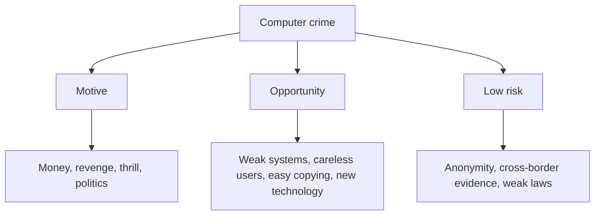

**In simple words:** a computer crime (cybercrime) is any illegal act in which a computer or network is the tool, the target or the place of the crime. Criminals attack because it is cheap, it pays well, and they are rarely caught. <Cite id="ethics-privacy-wiki-cybercrime" /> <Cite id="note-information-security-gfg-cybercrime" />

**Examples of computer crimes:** hacking, phishing, identity theft, online fraud, ransomware and spreading viruses.

**Main reasons** <Cite id="ethics-privacy-gfg-cybercrime-causes" /> <Cite id="ethics-privacy-gfg-cyber-criminals" />

| # | Reason | Short example |
|---|---|---|
| 1 | **Weak systems:** unpatched software, weak passwords, poor access control | Attackers use an old unpatched server |
| 2 | **Lack of awareness:** users click phishing links, reuse passwords, share OTPs | A fake bank SMS steals a card number |
| 3 | **Financial gain:** fraud, ransomware and selling stolen data pay well | Ransomware demands payment in cryptocurrency |
| 4 | **Easy copying of data:** digital data can be copied in seconds, often leaving little trace | An employee copies a customer list to a pen drive |
| 5 | **Anonymity:** the attacker is far away and hidden | A fraudster calls from another country |
| 6 | **Low chance of being caught:** evidence is hard to collect across borders | Cases remain unsolved for years |
| 7 | **Insiders:** staff with legitimate access misuse it | A clerk sells customer data |
| 8 | **Revenge, thrill or political motives** | A former employee deletes files |
| 9 | **Fast change in technology:** new tools appear before defences | Deepfake voice scams |
| 10 | **Personal data exposed online:** social media shows location and habits | Stalking and identity theft |

**Prevention in one line:** patch systems, train users, control access, back up data, and report crimes under the IT Act, 2000.

**Conclusion:** computer crimes happen where motive, opportunity and low risk meet; reducing opportunity and raising the chance of being caught are the best defences.
