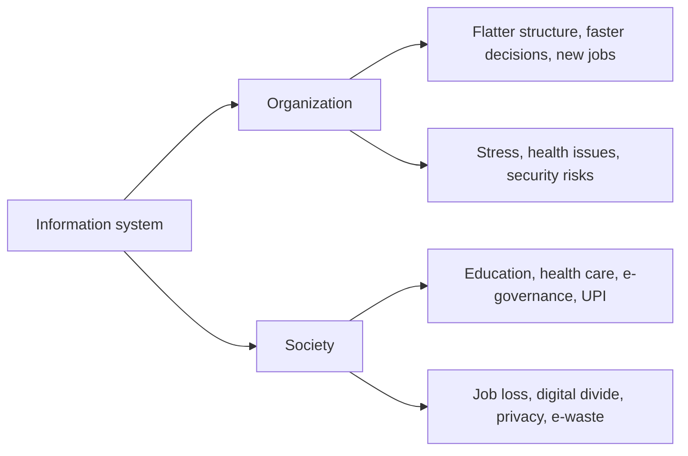

**In simple words:** information system (IS) people, hardware, software, data aur procedures ka set hai jo information collect, process aur share karta hai. Firm ke andar ye structure, jobs aur decisions badalta hai. Firm ke bahar ye badalta hai ki log kaise jeete, seekhte, shopping karte aur health care paate hain. Bijli ki tarah: ghar aur schools roshan hote hain, lekin unsafe wiring nuksan karti hai aur jinke paas connection nahi wo peeche reh jaate hain. <Cite id="it-impact-society-rainer-iis7" loc="Ch. 1" />

**Part 1: organizations pe impact**

1. **Flatter structure:** systems reports collect aur summarize karte hain, isliye kam middle managers chahiye.
2. **Behtar aur faster decisions:** managers ko kagaz ke dher ki jagah dashboards dikhte hain.
3. **Business processes badalte hain:** kaam system ke around redesign hota hai (business process re-engineering).
4. **Behtar coordination:** departments ek database share karte hain, isliye sales, stores aur accounts ko wahi numbers dikhte hain.
5. **Jobs badalte hain:** routine jobs automate hote hain aur developers, analysts aur security staff ke naye jobs aate hain.
6. **Employee health:** screen pe lambe ghante eye strain, back pain aur repetitive strain injury karte hain.
7. **Naye risks:** systems pe dependence, cyber attacks aur data breaches. <Cite id="it-impact-society-gfg-media-society" />

**Part 2: society pe impact**

1. **Quality of life:** online shopping, banking, booking aur government services time aur travel bachate hain.
2. **Automation aur robots:** robots khatarnak ya repetitive kaam karte hain, jaise car factories mein welding.
3. **Health care:** electronic health records aur online consultation (telehealth) door ke patients tak pahunchte hain. <Cite id="it-impact-society-wiki-telehealth" />
4. **Education:** NPTEL aur SWAYAM courses internet wale kisi bhi insaan tak pahunchte hain.
5. **Government services:** income-tax e-filing aur UPI payments queues aur paperwork kam karte hain.
6. **People with disabilities:** assistive technology unhe padhne aur kaam karne deti hai.

| Positive | Negative |
|---|---|
| Convenience, information tak access | Job loss aur reskill ki zaroorat |
| Behtar health care aur education | Privacy aur security risks |
| Kam cost, wider reach | Digital divide, fake news, e-waste <Cite id="it-impact-society-wiki-digital-divide" /> |

**Conclusion:** information systems organizations aur society dono ko behtar banate hain, lekin managers aur governments ko job change, privacy, security aur equal access sambhalna padta hai.
