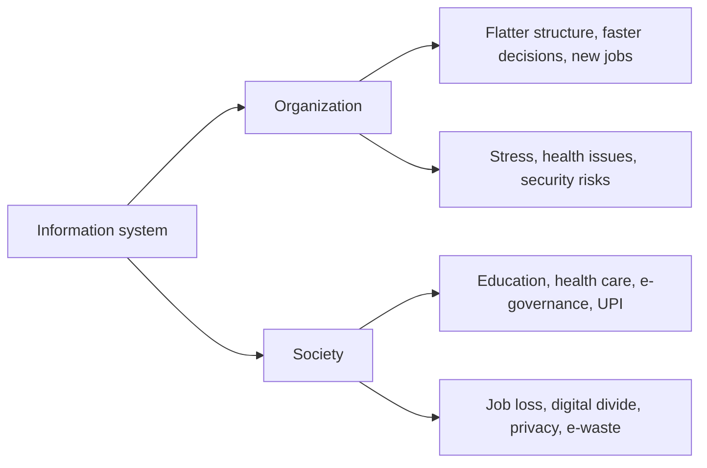

**In simple words:** an information system (IS) is people, hardware, software, data and procedures that collect, process and share information. Inside a firm it changes structure, jobs and decisions. Outside the firm it changes how people live, learn, shop and get health care. Like electricity in a town, it lights up homes and schools, but unsafe wiring hurts and houses without a connection fall behind. <Cite id="it-impact-society-rainer-iis7" loc="Ch. 1" />

**Part 1: impact on organizations**

1. **Flatter structure:** systems collect and summarize reports, so fewer middle managers are needed.
2. **Better and faster decisions:** managers see dashboards instead of piles of paper.
3. **Changed business processes:** work is redesigned around the system (business process re-engineering).
4. **Better coordination:** departments share one database, so sales, stores and accounts see the same numbers.
5. **Jobs change:** routine jobs are automated and new jobs appear for developers, analysts and security staff.
6. **Employee health:** long screen hours cause eye strain, back pain and repetitive strain injury.
7. **New risks:** dependence on systems, cyber attacks and data breaches. <Cite id="it-impact-society-gfg-media-society" />

**Part 2: impact on society**

1. **Quality of life:** online shopping, banking, booking and government services save time and travel.
2. **Automation and robots:** robots do dangerous or repetitive work, such as welding in car factories.
3. **Health care:** electronic health records and online consultation (telehealth) reach far-away patients. <Cite id="it-impact-society-wiki-telehealth" />
4. **Education:** NPTEL and SWAYAM courses reach anyone with internet.
5. **Government services:** income-tax e-filing and UPI payments cut queues and paperwork.
6. **People with disabilities:** assistive technology lets them study and work.

| Positive | Negative |
|---|---|
| Convenience, access to information | Job loss and need to reskill |
| Better health care and education | Privacy and security risks |
| Lower cost, wider reach | Digital divide, fake news, e-waste <Cite id="it-impact-society-wiki-digital-divide" /> |

**Conclusion:** information systems improve both organizations and society, but managers and governments must handle job change, privacy, security and equal access.
