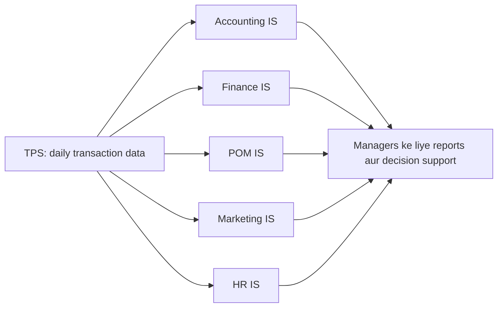

**In simple words:** ek company mein accounts, finance, production, marketing aur HR jaise departments hote hain. Functional Area Information System (FAIS) wo computer system hai jo ek department ko serve karta hai. Ye transaction processing system (TPS) ke daily data se us department ko plan, control aur decide karne mein madad deta hai. <Cite id="crm-rainer-iis" />

**Definition:** functional area information system organization ke ek functional area (department), jaise accounting ya marketing, ki activities ko support karta hai. <Cite id="note-tps-fais-erp-wiki-functional-area" />

**Har FAIS ka support**

| FAIS | Kya support deta hai | Example |
|---|---|---|
| Accounting IS | Paise ke saare events record aur report karta hai: ledger, payables aur receivables, billing, payroll, budgets, financial statements; audit aur internal control mein madad | Vendor ko pay karne se pehle invoice, goods receipt aur purchase order match karta hai <Cite id="note-tps-fais-erp-wiki-ais" /> |
| Finance IS | Paise ka aana-jaana manage karta hai: cash management, investment decisions, budgeting, forecasting, credit aur risk analysis | Firm agle quarter ka cash forecast karti hai aur surplus kahan invest karna hai decide karti hai |
| Production/operations (POM) IS | Goods ya services banane ko plan aur control karta hai: inventory control, purchasing, production scheduling, quality control, maintenance, logistics | Material requirements planning batata hai kya kharidna hai aur product kab banana hai <Cite id="note-tps-fais-erp-wiki-mrp" /> |
| Marketing IS | Product, price, place aur promotion ko support karta hai: market research, customer data, sales forecasting, sales tracking, pricing, advertising results | Flipkart dekhta hai kaunse offers kis city mein sales badhate hain |
| Human resources IS | Logon ko manage karta hai: recruitment, records, payroll, attendance aur leave, training, appraisal, workforce planning | HRIS payslips deta hai aur training aur leave track karta hai <Cite id="note-tps-fais-erp-wiki-hris" /> |

**Managers ko diye jaane wale reports:** routine reports (daily sales summary), ad hoc reports (pichle hafte ek city mein ek product ki sales) aur exception reports (reorder level se neeche items). <Cite id="it-impact-society-tp-mis" />

**Limitation:** har FAIS ek department ke liye bana hai, isliye data repeat hota hai aur match nahi karta. ERP is problem ko saare departments ko ek database par jodkar solve karta hai.

**Conclusion:** paanchon FAIS har department ko plan, control aur decide karne ke liye zaroori information dete hain.
