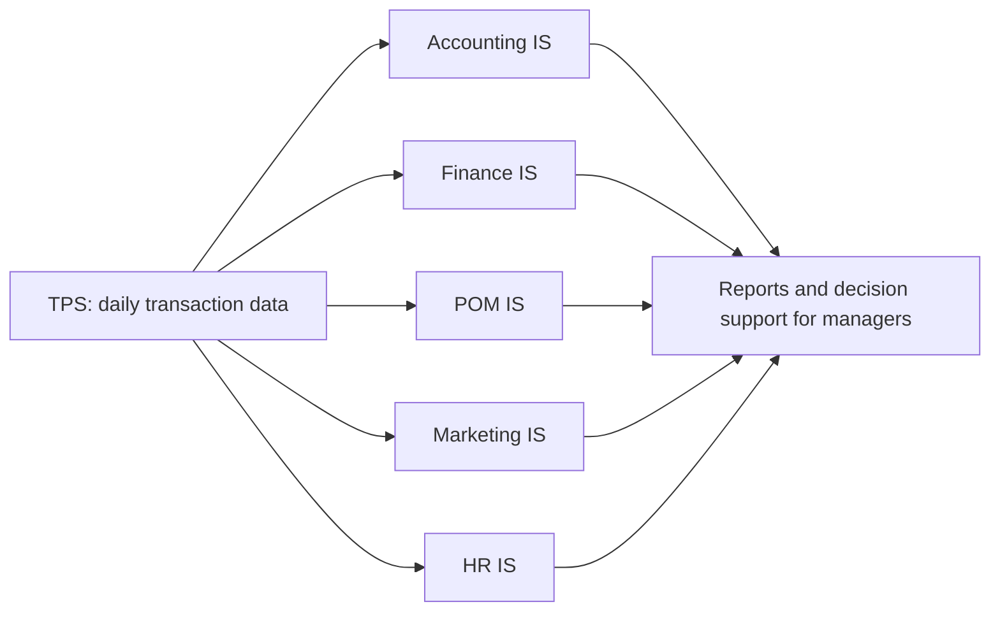

**In simple words:** a company has departments such as accounts, finance, production, marketing and HR. A Functional Area Information System (FAIS) is the computer system that serves one department, using the day-to-day data from the transaction processing system (TPS) to help that department plan, control and decide. <Cite id="crm-rainer-iis" />

**Definition:** a functional area information system supports the activities of one functional area (department) of the organization, such as accounting or marketing. <Cite id="note-tps-fais-erp-wiki-functional-area" />

**Types of support given by each FAIS**

| FAIS | Support it provides | Example |
|---|---|---|
| Accounting IS | Records and reports all money events: ledger, payables and receivables, billing, payroll, budgets, financial statements; helps audit and internal control | Matches an invoice, goods receipt and purchase order before paying a vendor <Cite id="note-tps-fais-erp-wiki-ais" /> |
| Finance IS | Manages money in and out: cash management, investment decisions, budgeting, forecasting, credit and risk analysis | A firm forecasts next quarter's cash and decides where to invest the surplus |
| Production/operations (POM) IS | Plans and controls making goods or services: inventory control, purchasing, production scheduling, quality control, maintenance, logistics | Material requirements planning works out what to buy and when to make a product <Cite id="note-tps-fais-erp-wiki-mrp" /> |
| Marketing IS | Supports product, price, place and promotion: market research, customer data, sales forecasting, sales tracking, pricing, advertising results | Flipkart studies which offers raise sales in which city |
| Human resources IS | Manages people: recruitment, records, payroll, attendance and leave, training, appraisal, workforce planning | A HRIS gives payslips and tracks training and leave <Cite id="note-tps-fais-erp-wiki-hris" /> |

**Reports given to managers:** routine reports (daily sales summary), ad hoc reports (sales of one product in one city last week) and exception reports (items below reorder level). <Cite id="it-impact-society-tp-mis" />

**Limitation:** each FAIS is built for one department, so data gets repeated and may not match. ERP solves this by joining all departments on one database.

**Conclusion:** the five FAIS give each department the information it needs to plan, control and decide.
