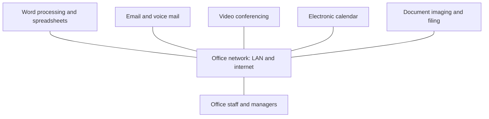

**In simple words:** office automation system (OAS) computers, software aur networks se office ka routine paperwork karta hai: letters type karna, messages bhejna, files rakhna aur meetings book karna. Jaise ghar ke liye washing machine, waise office ke liye OAS: kaam wahi, par repetitive hissa machine karti hai. <Cite id="is-fundamentals-wiki-oa" />

**Definition:** OAS computers, software aur communication networks ka use hai, jisse roz ke office kaam ki information banayi, collect, store, manipulate aur bheji jaati hai. <Cite id="is-fundamentals-gfg-types" />

**Kyun zaroori hai:** manual office kaam slow hota hai, bahut paper lagta hai aur information dhoondhna mushkil hota hai. OAS staff ko zyada productive banata hai aur communication behtar karta hai.

**Components aur functions**

| Function | Tools | Example |
|---|---|---|
| Document creation | Word processor, spreadsheet, presentation | Circular ya budget sheet banana |
| Communication | Email, voice mail, instant messaging | Saare staff ko notice bhejna |
| Meetings | Video conferencing | Mumbai aur Pune offices ki online meeting |
| Scheduling | Electronic calendar | Meeting room book karna |
| Document management | Scanning, electronic filing | Scanned admission forms store karna |
| Data sharing | LAN par shared drives | Sab latest file kholte hain |

**Ek din mein ye kaise kaam karta hai:** clerk letter type karke shared drive par save karta hai; manager email se approve karta hai; letter email se jaata hai aur reply scan karke file hota hai; follow-up meeting shared calendar par book hoti hai.

**Advantages:** tez kaam, kam paper aur jagah, sasti aur jaldi communication, aasaan search, behtar coordination.

**Disadvantages:** setup aur training cost, data loss ya viruses ka risk, network aur bijli par dependence, staff ka resistance, clerical jobs kam hona.

**Applications:** college offices, banks, government e-offices, hospital front desks, corporate offices. <Cite id="is-fundamentals-wiley-rainer" />

**Conclusion:** OAS office ka kaam tez karta hai aur TPS ke saath information system pyramid ke base par baithta hai.
