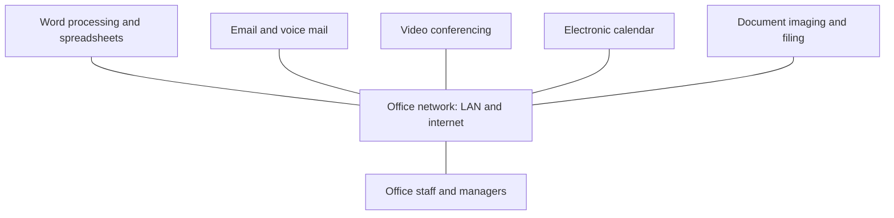

**In simple words:** an office automation system (OAS) uses computers, software and networks to do the routine paperwork of an office: typing letters, sending messages, keeping files and booking meetings. It is to an office what a washing machine is to a home: the same work, but the machine does the repetitive part. <Cite id="is-fundamentals-wiki-oa" />

**Definition:** an OAS is the use of computers, software and communication networks to create, collect, store, manipulate and send the information needed for everyday office work. <Cite id="is-fundamentals-gfg-types" />

**Why it is needed:** manual office work is slow, uses a lot of paper and makes information hard to find. OAS makes staff more productive and improves communication.

**Components and functions**

| Function | Tools | Example |
|---|---|---|
| Document creation | Word processor, spreadsheet, presentation | Preparing a circular or budget sheet |
| Communication | Email, voice mail, instant messaging | Sending a notice to all staff |
| Meetings | Video conferencing | Mumbai and Pune offices meet online |
| Scheduling | Electronic calendar | Booking a meeting room |
| Document management | Scanning, electronic filing | Storing scanned admission forms |
| Data sharing | Shared drives on a LAN | Everyone opens the latest file |

**How it works in a day:** a clerk types a letter and saves it on the shared drive; the manager approves it by email; it is sent by email and the reply is scanned and filed; a follow-up meeting is booked on the shared calendar.

**Advantages:** faster work, less paper and space, cheap quick communication, easy search, better coordination.

**Disadvantages:** setup and training cost, risk of data loss or viruses, dependence on network and power, staff resistance, fewer clerical jobs.

**Applications:** college offices, banks, government e-offices, hospital front desks, corporate offices. <Cite id="is-fundamentals-wiley-rainer" />

**Conclusion:** OAS speeds up office work and sits at the base of the information system pyramid with TPS.
