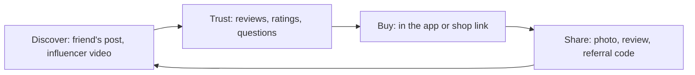

**In simple words:** social commerce wo online shopping hai jo social media ke andar hoti hai ya uske guide se hoti hai: friends ke posts, reviews, ratings, group deals aur influencer videos customer ko decide karne aur kharidne mein madad karte hain. Ye kharidne se pehle dosto se poochne jaisa hai, bas online hazaaron dost hote hain. <Cite id="social-computing-wiki-social-commerce" />

**Definition:** social commerce wo e-commerce hai jo social media aur logon ki opinions aur actions (sharing, recommending, rating, group buying) use karke customers ko products dhoondhne, chunne aur kharidne mein madad karta hai. <Cite id="it-impact-society-rainer-iis7" />

**Customers ko benefits**

1. **Trust aur confidence:** asli buyers ke reviews aur ratings kharab products se bachate hain (Amazon, Flipkart, Myntra ratings).
2. **Behtar discovery:** recommendations aur trending lists aise products dikhate hain jo buyer ne search hi nahi kiye the.
3. **Kam price:** group deals, referral rewards aur community ke shared coupons.
4. **Convenience:** discover, poochna aur kharidna ek hi app mein (Instagram ya Facebook Shops).
5. **Jaldi two-way help:** customer seller ya doosre buyers se pooch sakta hai aur jaldi jawab milta hai.
6. **Personalised offers:** interests aur pichli activity ke hisaab se.
7. **Kam risk:** asli users ki photos aur videos dikhate hain ki product real life mein kaisa dikhta hai.
8. **Fun aur apni awaaz:** friends ke saath shopping, live shows, aur apna experience share karna.
9. **Purchase ke baad help:** brand pages aur communities problems solve karte hain.

<Cite id="e-commerce-wiki-social-commerce" />

**Customers ke liye limits:** fake ya paid reviews, privacy ki chinta (personal data platforms ke saath share hota hai), friends ya influencers ki wajah se kharidne ka pressure, aur chhota seller unreliable ho to kharab service.

**Example:** ek Meesho reseller WhatsApp par kurti share karta hai; friends asli customers ki photos aur ratings dekhte hain, referral code se discount lete hain, aur kuch taps mein kharid lete hain.

**Conclusion:** social commerce customers ko trust, choice, price benefits aur convenience deta hai, bas fake reviews aur privacy risks se savdhaan rehna hoga.
