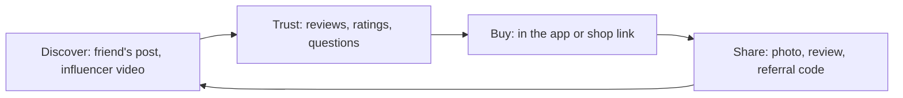

**In simple words:** social commerce is online shopping that happens inside, or is guided by, social media: friends' posts, reviews, ratings, group deals and influencer videos help a customer decide and buy. It is like asking your friends before buying, but with thousands of friends online. <Cite id="social-computing-wiki-social-commerce" />

**Definition:** social commerce is e-commerce that uses social media and the opinions and actions of people (sharing, recommending, rating, group buying) to help customers find, choose and buy products. <Cite id="it-impact-society-rainer-iis7" />

**Benefits to customers**

1. **Trust and confidence:** reviews and ratings from real buyers help avoid bad products (Amazon, Flipkart, Myntra ratings).
2. **Better discovery:** recommendations and trending lists show products the buyer would not have searched for.
3. **Lower price:** group deals, referral rewards and coupons shared by the community.
4. **Convenience:** discover, ask and buy in the same app (Instagram or Facebook Shops).
5. **Quick two-way help:** the customer can ask the seller or other buyers and get a fast answer.
6. **Personalised offers:** based on interests and past activity.
7. **Less risk:** photos and videos from real users show how the product looks in real life.
8. **Fun and a voice:** shopping with friends, live shows, and sharing one's own experience.
9. **Help after purchase:** brand pages and communities solve problems.

<Cite id="e-commerce-wiki-social-commerce" />

**Limits for customers:** fake or paid reviews, privacy worries (personal data is shared with platforms), pressure to buy because of friends or influencers, and bad service if the small seller is unreliable.

**Example:** a Meesho reseller shares a kurti on WhatsApp; friends see real customer photos and ratings, use a referral code for a discount, and buy in a few taps.

**Conclusion:** social commerce gives customers trust, choice, price benefits and convenience, if they stay alert to fake reviews and privacy risks.
