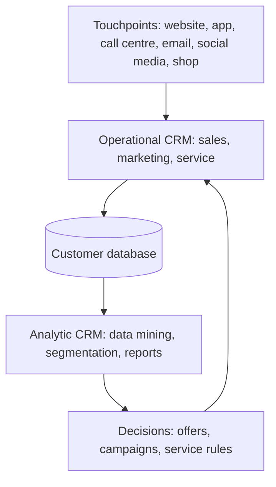

**In simple words:** chhota dukaandaar yaad rakhta hai ki aap kam chini lete ho aur monthly hisaab rakhta hai. Wo yaad rakhna hi CRM hai. Bade firm ke millions of customers hote hain, isliye software yaad rakhta hai aur har department ko same customer picture dikhti hai. <Cite id="crm-gfg-intro" />

**Definition:** Customer Relationship Management (CRM) ek strategy hai, jo information systems se supported hai. Ye firm ke customers aur firm ke saath unke saare contacts ki information ek jagah jama karti hai, taaki firm ka har hissa har customer ko achhe se serve kar sake aur customers ko rakh aur badha sake. <Cite id="crm-rainer-iis" /> <Cite id="crm-salesforce" />

**Kyun zaroori hai:** bade firm mein sales, support aur billing apne alag notes rakhte hain, isliye customer ko wahi kahani baar-baar sunani padti hai. Naya customer jodna purane ko rakhne se mehnga bhi padta hai.

**CRM ke types** <Cite id="crm-techtarget-types" /> <Cite id="crm-tpoint-types" />

| Type | Kya karta hai | Example |
|---|---|---|
| Operational | Daily front-office kaam automate karta hai: sales force automation, marketing automation, service tickets, call centre, chat | Complaint par Flipkart agent aapke orders aur pichli chats ek saath dekh leta hai |
| Analytic | Stored customer data ka study: segmentation, data mining, churn aur lifetime value, dashboards | Amazon ke "customers who bought this also bought" suggestions |
| Marketing | Campaigns plan karta hai: sahi customer, offer, channel aur time; loyalty programmes | Zomato noon mein order karne walon ko lunch offer bhejta hai |
| Collaborative | Customer data departments aur partners ke beech share karta hai | Car maker, dealer aur service centre same customer history dekhte hain |

**Benefits:** behtar service, zyada loyal customers, targeted marketing, zyada cross-selling aur upselling. **Limits:** high cost, kharab data quality, staff ka resistance, aur privacy ki zimmedari.

**Conclusion:** CRM operational, analytic, marketing aur collaborative hisson ko jodkar customers ko jaanta aur rakhta hai.
