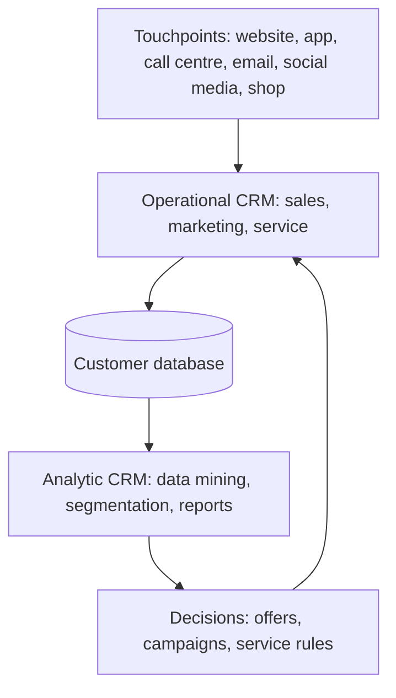

**In simple words:** a small shopkeeper remembers that you take less sugar and keeps your monthly account. That memory is CRM. A big firm has millions of customers, so software does the remembering and every department sees the same customer picture. <Cite id="crm-gfg-intro" />

**Definition:** Customer Relationship Management (CRM) is a strategy, supported by information systems, that gathers all information about a firm's customers and their contacts with the firm in one place, so every part of the firm can serve each customer well and keep and grow its customers. <Cite id="crm-rainer-iis" /> <Cite id="crm-salesforce" />

**Why needed:** in a big firm, sales, support and billing each keep their own notes, so the customer repeats the same story. Winning a new customer also costs more than keeping an old one.

**Types of CRM** <Cite id="crm-techtarget-types" /> <Cite id="crm-tpoint-types" />

| Type | What it does | Example |
|---|---|---|
| Operational | Automates daily front-office work: sales force automation, marketing automation, service tickets, call centre, chat | A Flipkart agent sees your orders and past chats at once when you complain |
| Analytic | Studies stored customer data: segmentation, data mining, churn and lifetime value, dashboards | Amazon's "customers who bought this also bought" suggestions |
| Marketing | Plans campaigns: right customer, offer, channel and time; loyalty programmes | Zomato sends a lunch offer to people who order at noon |
| Collaborative | Shares customer data across departments and partners | A car maker, its dealer and service centre see the same customer history |

**Benefits:** better service, more loyal customers, targeted marketing, more cross-selling and upselling. **Limits:** high cost, poor data quality, staff resistance, and privacy duties.

**Conclusion:** CRM joins operational, analytic, marketing and collaborative parts to know and keep customers.
