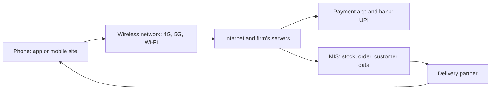

**In simple words:** e-commerce ek aisi shop hai jahan aap computer ke saamne baithkar jaate ho. Mobile commerce (m-commerce) ek aisa dukaandaar hai jo aapki pocket mein aapke saath chalta hai: aap phone se kahin bhi kharidte, bechte aur pay karte ho. <Cite id="e-commerce-wiki-mcommerce" />

**Definition:** m-commerce smartphones aur tablets jaise wireless handheld devices se, apps, mobile websites, SMS ya QR codes use karke, kharidna, bechna aur pay karna hai. <Cite id="e-commerce-investopedia-mcommerce" /> <Cite id="e-commerce-rainer-intro-is" />

**Kyun zaroori hai:** India mein zyada log computer se zyada phone se internet use karte hain. Phone personal hai, hamesha saath rehta hai aur location jaanta hai, isliye firm customer tak kahin bhi, sahi moment par pahunch sakti hai.

**Applications**

- **Mobile shopping:** Amazon, Flipkart, Myntra apps.
- **Mobile payments aur banking:** UPI apps (Google Pay, PhonePe), SBI YONO.
- **Food aur quick delivery:** Zomato, Swiggy, Blinkit.
- **Tickets aur travel:** IRCTC, BookMyShow, Ola, Uber.
- **Location-based services:** nearby offers aur maps.
- **Entertainment:** music, video aur games.

**Advantages:** kahin bhi, kabhi bhi use; personal aur location-based offers; fast payment; unhe bhi reach karta hai jinke paas computer nahi. **Disadvantages:** chhoti screen; phone kho jaye ya chori ho; fake apps aur public Wi-Fi ke risks; network par dependence; privacy ki chinta.

| Point | E-commerce | M-commerce |
|---|---|---|
| Device | Computer, laptop | Smartphone, tablet |
| Use | Aam taur par fixed jagah par | Chalte hue |
| Location | Aam taur par use nahi hota | Use hota hai (GPS offers, tracking) |
| Payment | Card, net banking | UPI, wallet, QR code |

<Cite id="e-commerce-gfg-ecom-vs-mcom" />

**Conclusion:** m-commerce e-commerce ko personal, mobile aur fast banata hai, aur aaj Indians ke kharidne aur pay karne ka main tareeka hai.
